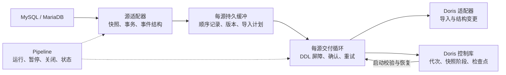

# MySQL / MariaDB 到 Doris 的 CDC 重构设计

本文是 `pkg/cdc` 的实现与验收草案。现有实现位于 [pkg/hcdc](../hcdc)。首期保留嵌入式 Go SDK、本地磁盘缓冲和 Doris Stream Load，优先解决断点续传、结构演进、故障恢复和运行生命周期。新旧实现可以并行验证，生产切换按源实例进行。

## 1. 现状与设计目标

当前实现按表封存、上传文件，按源实例汇总恢复位点。已在本地复现较早事件仍在 A 表的临时文件中，B 表先上传后却返回更晚的实例位点。类似的问题还出现在行事件提前携带事务 GTID、业务导入与位点更新分离、全量和增量采用不同过滤对象、恢复结构混用源列序与目标建表列序。重构需要集中解决这些跨模块约束。 [Worker 扫描](../hcdc/worker.go) · [文件协议](../hcdc/file.go) · [源事件处理](../hcdc/canal.go) · [目标写入](../hcdc/doris.go)

| 目标 | 可验收结果 |
| --- | --- |
| 连续交付 | 对每个源，恢复位点只覆盖从起点开始连续、已确认交付的完整事务。较晚文件就绪时，较早的缺口仍阻止位点前进。 |
| 可恢复写入 | 在任何一次本地写入、Doris 导入、位点写入或清理之间重启，都能恢复可验证的进度，或进入有明确原因的阻塞状态。 |
| 数据保真 | 全量与增量采用同一选表规则及同一类型转换规则。目标正确区分 NULL、空值和实际数值，主键修改按旧键删除、新键写入处理。 |
| 可追溯结构 | 每条变更使用源事件发生时的结构版本。目标 DDL 通过顺序屏障，生效后才处理依赖新结构的数据。 |
| 可运维 | 运行、暂停、失败、停止均可查询。积压和位点不会因暂停失去观测，磁盘达到上限时对源端施加背压。 |

首期支持单进程内管理多个源，要求每条流水线有一个活动写入者。同源按顺序确认，不同源可并行。交付语义为 **对未确认批次至少一次尝试，已确认事务按序推进，目标状态按主键收敛**。跨表或拆批的同一源事务可能部分可见。跨 Doris 表原子可见、永久 exactly-once、自动主备接管和无主键表镜像属于后续范围。

## 2. 模块、接口与并发模型



| 模块 | 对外或对内接口 | 模块拥有的规则 |
| --- | --- | --- |
| `Pipeline` | 由 `Manager.SetConfig(ctx, cfg)` 或监控 SDK 的 `Start(ctx, sourceID)` 启动单源实例，提供 `Pause(ctx, reason)`、`Resume(ctx)`、`ApproveDDL(ctx, id)`、`Status()` 和 `Close(ctx)`。 | 校验配置，持有该源的生命周期和资源。 |
| `Manager` | 以 `NewManager(serviceCtx)` 创建，调用 `SetConfig(ctx, *Config)` 提交完整的期望源列表，通过 `Pipeline(sourceID)` 取得当前句柄。 | 校验配置和所有权冲突，增删源，并对有变化的源执行有序交接。 |
| 源适配器 | 对交付内核提供一致性快照、从指定游标订阅、输出已提交事务或有序 DDL。 | 维护 MySQL/MariaDB 事件解析、源表物理列序、GTID 集合及连接验证。封装 `go-mysql` 的复制协议。 |
| 持久缓冲 | 提供追加并确认持久化、按序恢复、读取待交付记录、保存导入计划及回收已确认记录。 | 拥有文件版本、校验和、空间水位和崩溃恢复。交付循环无需了解后缀或目录扫描顺序。 |
| 交付循环 | 消费每源顺序记录，向目标适配器提交导入计划或执行 DDL，确认后发布检查点。 | 统一处理连续前缀、重试、暂停、结构屏障，以及业务成功但位点结果未知的情况。 |
| Doris 适配器 | 提供生成目标结构、导入批次、查询或核对批次结果、核对目标 DDL 与写读检查点。 | 封装 CSV、HTTP 和 SQL 细节。返回可区分的成功、可重试、结果不确定和需人工处理状态。 |

建议包根目录保留 SDK 与公共配置，内部按源适配器、持久缓冲、交付、Doris 分开。源与目标两侧各有真实实现和测试替身，可在这些接口上做确定性测试。文件格式与转换细节留在对应模块内，纯计算直接测试。

每个源的采集与交付分别运行，之间以持久缓冲解耦。同一源只交付一个有序记录，分表或分片按计划顺序执行。跨源 Stream Load 总并发由部署管理。网络等候、队列阻塞和退避响应取消。进程内拒绝已配置端点上的目标映射冲突和重复 `SourceID`，同一缓冲目录依靠独占锁保证单活。

### 2.1 代码规范

- **Go 格式与接口**。使用 `gofmt` 保持格式一致。只有调用方需要的配置、类型和生命周期方法才导出。导出类型和方法的文档注释以标识符开头，说明调用前置条件、返回时的状态和并发约定。小接口由使用方定义，复用已有转换与校验逻辑。
- **错误处理**。统一使用 `pkg/herror`。用 `herror.NewError` 创建本模块的独立错误，用 `herror.Wrap` 或 `herror.WrapMsg` 包装确认非空的底层错误并保留错误链。I/O、解码、落盘和远端确认失败沿调用链返回，通过 `errors.Is` 或 `errors.As` 识别取消、可重试、结果不确定和需人工处理等情况。异常需要堆栈时，由负责处置的调用边界执行一次 `herror.PrintStack(ctx, err)`。 [herror 实现](../herror/error.go)
- **日志**。统一使用 `pkg/hlog` 的 `Debug`、`Info`、`Warn`、`Error`，传入当前操作的 `context.Context`，保留已有追踪 ID。需要创建追踪 ID 时，在入口通过 `hlog.WithContext(ctx, hlog.NewTraceId())` 派生可取消的上下文。在决定重试、暂停或停止的模块集中记录，按场景附上源身份、事务、位点和批次标识。凭据和原始业务数据不写入日志。 [日志接口](../hlog/log.go) · [追踪上下文](../hlog/ctx.go)
- **并发与资源**。`context.Context` 放在需要取消的函数首参，并传入网络、SQL、队列等待和退避。每个 goroutine、文件句柄和连接池有明确的所有者和关闭路径。把远端请求移出共享状态锁的临界区，说明取消返回后哪些操作可能已经生效。
- **数据与持久化**。封存、发送、确认、推进检查点和回收分别使用含义明确的操作。涉及格式、映射或检查点语义的变更应说明对旧数据的兼容方式，并补上恢复回归测试。注释重点记录持久化顺序、幂等前提和边界条件。
- **提交前验证**。实现进入仓库后，对变更包执行格式检查、`go vet` 和 `go test`。涉及并发、停机或共享状态的改动执行 `go test -race`。涉及协议或恢复语义的改动按第 6 节补充对应验收用例。

### 2.2 专业命名

代码标识符使用清晰的英文领域术语，同一概念在 Go 类型、SQL 字段、日志和测试中保持一致。遵循 Go 的惯用大小写，例如 `SourceID`、`GTIDSet`、`DDLRecord`、`HTTPClient`。包名用简短的小写词表明职责，如 `cdc`、`spool`、`doris`。函数和方法以动作命名，变量和类型以数据含义命名。

| 领域概念 | 命名示例 | 含义 |
| --- | --- | --- |
| 源身份与代次 | `SourceID`、`PipelineID`、`Generation` | 分别标识源、流水线及一次可独立恢复的运行代次。 |
| 源事务与位置 | `SourceTransaction`、`Cursor`、`BinlogPosition`、`GTIDSet` | 事务、完整恢复游标、物理位置和 GTID 集合各有明确类型。 |
| 读取、落盘与交付进度 | `ReadCursor`、`DurableCursor`、`DeliveredCursor`、`Checkpoint` | 三个游标对应第 3.2 节的不同进度。`Checkpoint` 专指可读回验证的持久化交付记录。 |
| 结构与变更 | `SourceSchemaVersion`、`TargetTableSchema`、`RowChange`、`DDLRecord` | 源结构包含物理列序，目标结构包含 Doris 列定义，行变更保留 before 与 after。 |
| 导入和确认 | `LoadPlan`、`LoadBatch`、`LoadLabel`、`ConfirmLoad`、`PersistCheckpoint` | 区分计划、单次导入批次、去重标识、远端结果确认和位点持久化。 |

命名应体现状态边界。例如，`AppendRecord` 的文档要说明返回成功时是否已经持久化，`ConfirmLoad` 表示已核对 Doris 导入结果，`PersistCheckpoint` 表示记录可用于恢复。避免在跨模块接口里使用 `data`、`info`、`handler`、`process` 等含义宽泛的名称。日志字段和 SQL 列名可用对应的蛇形写法，如 `source_id`、`generation`、`load_label`。涉及多个位置或时间的字段应写明阶段和单位，例如 `checkpoint_age_seconds`。

## 3. 数据模型和提交协议

### 3.1 数据模型

| 对象 | 最小字段和约束 |
| --- | --- |
| 流水线身份 | `PipelineID + SourceID + Generation`。同一代次固定逻辑源、订阅模式、表路由及转换配置。自动接入的表使用派生的独立流身份及检查点，共用库流水线的目标库写入权。GTID 模式为同一复制谱系保留代次，允许经过验证的主库切换。 |
| `Cursor` | 物理成员身份、binlog 文件与位置、flavor 和完整 GTID 集合。物理位点与 GTID 来自同一已提交事件。同一成员的物理位点须递增。GTID 模式跨成员时按已验证的 GTID 前缀比较进度。 |
| `OrderedRecord` | 本代次序号、源事务身份、提交游标、类型、依赖的结构版本。类型为已提交 DML、DDL 或游标进度记录。过滤后无数据的事务也可以形成进度记录。 |
| 行变更 | 源表标识、动作、before/after、键值。值区分缺失、NULL 和实际值。在完整行镜像下，主键变更可以生成旧键删除和新键写入。 |
| 结构版本 | 源表标识、生效游标及物理列序，列类型、无符号属性、主键顺序、字符集，以及删除墓碑。目标模型另存 Doris 列序、类型和分区规则。 |
| 导入计划 | 事务、目标表、稳定的分片序号、映射版本、行数、内容校验和及确定性 label。发出远端请求前持久记录。 |

### 3.2 三个位点

| 位点 | 推进条件 | 用途 |
| --- | --- | --- |
| 已读取 | 适配器收到事件。 | 观测和诊断。 |
| 已落盘 | 按源提交顺序，连续的完整记录及所需结构已写入持久缓冲。 | 使用原目录重启时，先重建待交付队列，源端从此处继续订阅。 |
| 已交付 | 连续记录的全部目标操作确认成功，且对应检查点已持久化并可读回。 | 缓冲回收与故障诊断。原缓冲丢失时作为重建进度的起点，重订阅前仍须处理可能已发生的未确认目标写入。 |

同一代次内始终满足 **已交付 ≤ 已落盘 ≤ 已读取**。行变更通过有界内存排序和磁盘归并暂存，等待 XID 或相应提交事件。回滚和源传输断开时丢弃未提交暂存。提交后以流式方式生成分批计划，将整笔事务作为校验记录原子落盘。按源顺序覆盖 DDL、DML 以及无数据事务，遇到不支持的事件或无法确定表结构时阻塞该源。精确记录事件类型和游标。 [事务规划](transaction_plan.go) · [流式落盘](delivery_stream.go)

### 3.3 持久性、重试和检查点

1. **落盘**。将记录和游标追加到带版本、长度和校验和的顺序文件，写入完成后执行文件同步。分段发布使用同文件系统原子重命名并同步目录。恢复时允许丢弃末尾未提交的残片并从已落盘位点重读。已发布段损坏、序号缺口、身份不一致均停止自动恢复。
2. **计划**。按已固定的目标映射生成每表的导入计划。对同一事务内重复操作同一个目标键，按源事件顺序求最终操作，避免依赖导入服务对批内重复键的排序。拆批后的标识和内容必须稳定，并在发送前持久化。
3. **写入**。label 绑定流水线、代次、源事务、目标表和分片，重试使用相同 label 和内容。确认记录需要关联原请求。超时、连接断开或重复 label 先查询实际状态。成功响应还须核对过滤行数和实际加载行数。无法证明成功或安全重放时阻塞当前源。
4. **确认**。所有分片确认后写入检查点，包含代次、序号、提交游标和结构引用。控制表保存可核对的检查点记录，按本代最大有效序号读取。检查点写入结果未知时先读回核对，禁止越过当前记录继续交付。检查点确认后才能删除对应缓冲。
5. **所有权**。原卷使用独占文件锁。启动时还要读回 Doris 中与原卷凭证绑定的目标库和控制流声明。跨卷接管需要先隔离旧写者并确认在途请求，详见生产手册。Doris label 有保留窗口，超期且确认信息不足时进入人工核对。无法核对原计划和已执行副作用时重建该代次。 [写入所有权](doris_ownership.go) · [发布前检查](PRODUCTION_RUNBOOK.md#21-写入所有权容量和恢复检查)

稳定 label、导入结果查询方式和保留窗口须在目标 Doris 版本上实测。若查询结果无法强关联同一请求，适配器应返回结果不确定。所需 binlog 被清理、源身份或 GTID 历史无法验证、恢复记录丢失时，进入待修复状态。恢复从原有连续前缀出发。

## 4. 功能设计

### 4.1 首次全量和切换增量

- 首期支持具有稳定主键的事务型源表。预检 `binlog_format=ROW`、`binlog_row_image=FULL`、权限、目标版本能力、路由冲突和 binlog 保留策略。行镜像模式与列元数据模式分别校验。无完整列名时依赖精确的源物理列序，无法确定则阻塞。
- 在适配器内用短写入同步窗口握手，将源快照与起始物理位点及 GTID 基线绑定。扫描全程读取同一个一致性视图，握手完成后可以继续源 DML。快照期间冻结所选表 DDL，或检测到所选表 DDL 后使本代次失效。MySQL、MariaDB 分别验证握手方案及权限，能力不足时采用有明确写入和 DDL 冻结窗口的全量流程。
- 按主键确定顺序扫描，支持复合键、字符串键、负数与无符号键。使用类型化范围参数，避免固定 `id` 和数值上界。快照导入配合独立代次，增量可以从基准位点先采集到缓冲，等快照确认后再交付。
- 快照默认按编码后的 Doris CSV 大小分批。批次达到 10 MiB、加入下一行会超出 10 MiB、首行累计满 5 秒或到达表尾时结束当前批次。显式设置 `SnapshotBatchRows` 时按指定行数分批，并保留 64 MiB 的硬上限。增量在每个已提交的源事务内按目标表拆批，10 MiB 为目标大小，各表尾批随事务交付。编码后超过 10 MiB 的单行单独成批，最大 64 MiB。已落盘的增量分批和原有 Label 在重启时继续用于恢复。
- 记录 `snapshot_loading`、`snapshot_complete` 等阶段。沿用原快照方式的库发生中断且一致性视图和准备证据均丢失时，从新的基准点重建影子目标。空表通过完成标记参与验收。快照完成后，提交第一条增量记录前核对基准游标及结构版本。

通过 `Canals` 建立新基线的库在首次启动时持久化可恢复快照标志和原始表清单。该流程覆盖首次 `Reload` 已发现并由 `Start` 启动的库、后台自动发现的库及通过 `Manager.SetConfig` 启动的库。清单内的所有表通过一次一致性快照读取，结构、完整批次和共同位点封存成功后才开始向 Doris 导入业务行。重启复用原卷、原配置和原代次。SDK 读回持久标志和原清单，按封存顺序核对回执并在证据允许时原样补发同 Label 批次。所有表的导入确认后逐表核对目标行数，包括空表，再发布该库共享的序号 `0` 基线，回收批次并从封存位点开始增量。后续新表可在库恢复后单独接入，其他库沿各自位点独立运行。 [快照启动与提交](pipeline.go) · [快照封存与恢复](staged_bootstrap.go)

旧版基线按卷内的原恢复模式打开。已完成的旧版基线按原检查点续传，有有效准备证据的旧版快照可继续核对并完成基线。旧版已部分导入且缺少恢复证据时，保留原库表与缓冲卷，使用新代次、空目标库和新目录重建。已写入封存标志的代次须使用支持该格式的 SDK 恢复。卷内原始表缺失、目标绑定改变、恢复证据冲突或所需 Binlog 已清理时，保留错误和现场供核对。 [兼容恢复](pipeline.go) · [封存格式](table_snapshot_spool.go)

自动接入的新表在 `table-streams/<表名>/snapshot-batches` 按序持久化完整的编码批次。源读视图结束后，校验目标为空，封存批次总数、源表结构、快照位点和 Doris 目标绑定，再发送业务数据。崩溃发生在封存前时，仅回收未发送的本地批次并重新取得一致性视图。封存后使用原持久卷和原 Doris SQL、FE、BE 地址恢复，核对目标表结构、批次校验和、导入回执和事务状态。已确认回执用于跳过已完成批次。Doris 返回缺失或已中止且未发现冲突证据时，按原 Label 补发相同的 UNIQUE KEY 行集。

全部批次确认后，读取 Doris 目标表行数，核对封存批次的总行数，再发布序号 `0` 基线和本地完成记录，最后回收批次并启动增量。新表导入和恢复期间，原有库流水线按自己的位点处理旧表。多库和单表子流并行初始化时，按完整编码快照的合计峰值另计磁盘预算，`MaxPendingBytes` 约束增量缓冲。保留源 Binlog 直到最早的封存位点完成续订和追平。 [快照封存与恢复](staged_bootstrap.go) · [快照暂存](table_snapshot_spool.go)

### 4.2 数据、过滤和 DDL

| 能力 | 首期行为 |
| --- | --- |
| 过滤和路由 | 快照、DML、DDL 只使用一份选择规则。兼容旧配置时，库正则匹配库名，表正则匹配裸表名，排除优先。显式限制同名源表的目标冲突。运行中筛选或映射变化通过新代次或显式回填处理。 |
| INSERT、UPDATE、DELETE | 完整支持多行事件、复合键和主键变更。验证负值、`BIGINT UNSIGNED`、DECIMAL、YEAR、时间、UTF-8、控制字符、二进制、JSON 和 Bitmap。明确 NULL、空字符串、缺失列的编码及不可映射值的阻塞条件。 |
| 初始建表和兼容加列 | 初始化按已选源表结构创建目标表。增量期间支持兼容的可空加列，在 Doris 确认生效后持久化新版本。运行时 CREATE 和未经实现的多表 DDL 会保留为阻塞屏障。 |
| TRUNCATE | 顺序消费为显式屏障。审批绑定本代次、具体操作和游标。Doris 确认原分区已替换且表为空后，才推进检查点并恢复后续导入。 |
| 删列、改类型、重命名 | 单个非键值列的删列、显式列改名、保持 Doris `BIGINT` 投影的无损整数扩宽可审批。键、表身份、实际目标类型变化及组合破坏性操作要求新代次。支持边界与实测见第 6.10 节。 |
| 无法解释的结构变更 | 停在对应事务，保留原事件与版本，等待补齐规则或选择重建代次。源端当前 `SHOW CREATE TABLE` 仅用于快照和人工核对，历史 DDL 从对应事件及上一版本推导。 |

### 4.3 自定义 Bitmap32 与 Bitmap64

源 MySQL/MariaDB 通过**列注释**声明 Roaring Bitmap 的二进制格式。两个标记都映射成 Doris 的非键 `BITMAP` 值列，标记决定源端解码器。推荐用容量足够的可变长二进制列，避免定长 `BINARY(n)` 的填充字节影响解码。例如 `members32 BLOB NOT NULL COMMENT 'CustomType=Bitmap32'` 和 `members64 LONGBLOB NOT NULL COMMENT 'CustomType=Bitmap64'`。 [旧实现的类型识别](../hcdc/cdc.go) · [Doris 类型映射](../hcdc/doris.go)

| 列注释标记 | 源端写入格式 | 元素范围 |
| --- | --- | --- |
| `CustomType=Bitmap32` | 与 Go `roaring.Bitmap.MarshalBinary()` 兼容的完整二进制数据 | `0` 至 `4294967295` |
| `CustomType=Bitmap64` | 与 Go `roaring64.Bitmap.MarshalBinary()` 兼容的完整二进制数据 | `0` 至 `18446744073709551615` |

- **识别规则**。旧版只在 `BINARY`、`VARBINARY`、`BLOB`、`MEDIUMBLOB`、`LONGBLOB` 上区分两个大小写敏感的子串，同时出现时优先识别为 Bitmap64。重构对这些列要求恰好一个合法标记，遇到冲突、未知 Bitmap 标记或不支持的列类型时报告配置或结构错误。注释、列类型和解码方式随结构版本保存，修改注释或切换 32/64 位格式按 DDL 屏障处理。变更前先确定存量值的迁移方案，保留旧事件的解码能力。 [旧实现的类型识别](../hcdc/cdc.go) · [源列定义解析](../hcdc/parse.go)
- **全量与增量统一解码**。两条路径从数据库驱动或 binlog 取得原始二进制，用同一个解码器解析完整载荷。应用写入时使用二进制绑定参数。CDC 展开位图得到无符号十进制成员列表，如 `1,7,4294967296`，对这段文本做 Base64 后放进 CSV 的临时列 `members_base`。Doris Stream Load 使用 `members=bitmap_from_string(from_base64(members_base))` 还原。成员始终用无符号格式输出，避免超过 `MaxInt64` 的值变成负数。 [旧实现的 Roaring 解码](../hcdc/canal.go) · [旧实现的 CSV 表达式](../hcdc/file.go) · [Doris BITMAP 导入](https://doris.apache.org/docs/3.x/data-operate/import/complex-types/bitmap/)
- **区分空集合、NULL 和坏数据**。空集合应由生产者写入合法的空 Roaring 序列化值，并在目标显式构造 `bitmap_empty()`。旧版会把解码失败、空集合和源 NULL 写成相同的空 CSV 字段。重构允许可空的源列声明，Doris 3.0.8 的目标列使用 `BITMAP NOT NULL`。全量和增量在实际值为 SQL NULL 时报告库表和列名并阻塞。零字节载荷、截断、解码后有多余字节或可识别的格式错配都报告错误，检查点停在该事务之前。写目标表时不继承源二进制列的 `DEFAULT`。 [旧实现的解码失败处理](../hcdc/canal.go) · [CSV 空字段](../hcdc/file.go) · [目标列与默认值](../hcdc/doris.go) · [Doris BITMAP_EMPTY](https://doris.apache.org/docs/3.x/sql-manual/sql-functions/scalar-functions/bitmap-functions/bitmap-empty/)
- **限制转换成本**。解码前校验载荷长度、格式头和声明的容器数，尤其要防止 Bitmap64 按异常容器数大量分配内存。Roaring 压缩值展开为成员列表再经 Base64 后，大小可能远超源载荷。按实际数据基数验证单值大小、转换后批次字节数和内存峰值。超过可导入上限时报告库表、列、位点和大小，并阻塞该记录；保留完整集合供重试或排查。

验收使用生产者生成的 Bitmap32 和 Bitmap64 二进制样本，分别覆盖全量、增量写入与重启续传。正例至少包含 `0`、`2^32-1`、Bitmap64 的 `2^32`、`2^63` 和 `2^64-1`，以及序列化空集合。用 Doris 的 `bitmap_count(col)` 验证基数，对小样本通过 `bitmap_to_string(col)` 核对具体成员。正例还应检查 Stream Load 过滤行数为零。负例覆盖 NULL 策略、零字节、损坏数据、32/64 位格式错配、冲突注释和超限载荷，断言错误可观测且失败记录的位点未被跳过。无符号上界、空集合和 NULL 行为以 Compose 中的 Doris 版本实测为准。 [Doris BITMAP_TO_STRING](https://doris.apache.org/docs/3.x/sql-manual/sql-functions/scalar-functions/bitmap-functions/bitmap-to-string/)

### 4.4 生命周期、暂停与观测

- 生命周期统一为启动中、运行中、交付暂停、需要人工处理、停止中、已停止。每源状态包含原因、时间、所涉库表、位点和当前操作。启动失败时回收已经创建的资源。
- 手动暂停以源为单位，等待当前目标请求进入可确认状态后停止派发新请求。采集继续直到磁盘高水位。恢复须通过结构、磁盘、检查点等前置检查。DDL 屏障与人工暂停均保存在可恢复的控制状态里，进程重启不会自动清除待审批项。
- 优雅关闭停止接受新工作，等待已在途操作或超时，保留未确认数据使下次恢复可继续。`Manager.SetConfig` 对需要替换的源复用优雅关闭，待旧流水线释放资源再启动替代实例。
- 指标按流水线和源区分已读取、已落盘、已交付，统计未提交事务、待交付事务、待确认批次、磁盘字节数、最老积压年龄、重试原因、过滤行数和 DDL 等待时间。内部控制表写入独立计量。暂停时持续更新磁盘与积压水位，硬阈值阻止继续读取。日志记录流水线、代次、事务、游标、label 和操作结果。

应用通过监控 SDK 的 `Reload(ctx, cfg)` 发现源库，再用 `Start(ctx, sourceID)` 启动单源实例。调用 `Status()` 可查看状态、三个进度、待交付字节数、采集背压和待审批 DDL 的 ID、类型、游标和目标布局。调用 `Pause(ctx, reason)` 持久化手动暂停并等待正在交付的记录完成确认。采集继续落盘，直到本地待交付记录达到 `MaxPendingBytes`，默认 256 MiB。该值按未确认记录的编码长度计量。单条记录超过预算时报告错误并保留恢复位置。采集持有完整记录却因容量不足等待时，`Status().Backpressured` 为真。

仅对当前可执行的待审批屏障调用 `ApproveDDL(ctx, status.PendingDDL.ID)`。审批与手动暂停分别持久化，因此审批后仍处于手动暂停时，需要显式调用 `Resume(ctx)`。`PendingDDL.Kind=unsupported` 时，状态原因要求新代次，`ApproveDDL` 返回对应原因。若控制文件已发布但目录同步失败，返回 `ErrControlOutcomeUnknown` 并阻塞新派发。下次控制操作先用相同序号和内容确认原操作。重启时同步并读取相同的控制目录，恢复暂停、审批和结构版本。调用 `Close(ctx)` 停止采集和新请求，允许在途记录完成。超过调用期限后取消在途操作，已封存记录及审批可在下次启动时核对。破坏性请求如果无法证实原操作已经生效，保留屏障等待核验。

#### 配置动态更新

调用 `SetConfig` 时提交本次期望运行的全部源。配置生效后通过 `Pipeline(sourceID)` 取得新的句柄，以便读取状态或执行暂停与审批。新增源从快照或已有检查点启动，列表中省略的源会优雅关闭。`SetConfig(ctx, nil)` 停止所有受管理的源。

`Config.Validate(ctx)` 在本地检查 Doris 连接参数、源规则和自动发现间隔，通过 `hlog` 记录错误。`Config.Equal(other)` 比较共享 Doris、各 Canal 的配置和自动发现间隔。`SetConfig` 会重新发现源库并校验资源冲突，然后比较实际应用的库表和连接配置。配置等价且各源仍处于活动状态时直接返回。已停止或失败的源仍可用同一配置恢复。

应用 YAML 中的 `CDC` 字段解码为 `hcdc.Config`。宿主可将配置交给 `Manager.SetConfig` 应用整组运行源，或使用 `monitor.Reload` 加载并逐源启动初始清单。多个 Canal 源共用 `Doris`。普通 `SchemaPrefix` 拼接源库名，使用 `{InstanceId}` 时将源实例编号加入目标库名。配置解析会拒绝目标库映射冲突。首次启动某个源时，快照自动建目标库和表。 [共享 Doris 配置示例](monitor/README.md#配置-doris-和-canals)

监控在 `Reload` 成功后按 `AutoDiscoverInterval` 轮询源端元数据，默认 30 秒。新库有符合规则的基础表时按相同的源身份、选表和目标命名规则启动，快照完成后从对应位点采集增量。已启动的库流水线以同一间隔发现新表，发现后先持久登记，再为每张新表启动独立子流。子流自动创建 Doris 表，完成一致性快照并从该表的快照位点开始增量。库流水线以原持久化清单恢复首次快照中的表，新增表的登记和检查点随原持久目录恢复。子流异常在单表状态中呈现，原有表继续同步。 [自动发现新库](monitor/README.md#自动发现新库) · [自动发现已有库的新表](monitor/README.md#自动发现已有库的新表)

自动接入表和原有表的位点独立，同一事务在不同流中的可见时间可能不同。源状态的 `Delivered` 记录原有表水位，新增表从 `DiscoveredTables` 读取状态和检查点。暂停阻止库流水线及子流接收新的业务交付任务，DDL 审批按所在流的屏障 ID 执行。对账和消费者发布保留原证据范围，新表以其自己的交付位点与显式范围重新验证。

每条 `Canals` 配置均可设置 `ZeroDatePolicy`。省略与 `reject` 等价，全量或增量遇到 `DATE`、`DATETIME`、`TIMESTAMP` 的 `0000-00-00` 时报告源库、表和列并停止。失败的全量不写入快照检查点，失败的增量事务不推进落盘或交付位点。设为 `epoch` 时沿用 hcdc，将日期部分转换为 `1970-01-01`，保留时分秒和小数。真实的 `1970-01-01` 仅在日期时间主键中被拒绝，避免与映射后的键合并。开启前检查业务表中真实的纪元日期主键。

`Config.Validate(ctx)` 拒绝未知策略，配置应用时会将省略值按 `reject` 处理。切换策略会改变持久映射版本，需使用新代次、新缓冲目录和空目标库。`Status().SnapshotZeroDateRows` 是已确认快照中的受影响行数。`Status().Progress.Durable.ZeroDateRows` 和 `Delivered.ZeroDateRows` 分别统计增量已落盘和已交付的累计影响行数，按事务归并后的目标行计数，包含删除行。单行命中多列只计一次，快照计数及增量累计随各自的持久记录恢复。

同代次可更新连接凭据、源复制客户端 ID，沿用原缓冲目录、控制库和检查点。同代次固定逻辑源身份、首次快照的表清单、选表规则、定位模式及 Doris 的 SQL、FE 和 BE 绑定。物理模式保持原源地址。GTID 模式换地址前，部署侧须按第 6.9 节隔离旧主并核对候选谱系，流水线启动时仍会校验 GTID。显式变更选表规则、表映射、物理源或目标绑定时使用新代次、独立目录和空目标库。相同规则下新出现的表可自动接入。

`serviceCtx` 决定运行生命周期，`updateCtx` 约束本次交接等待。已经完成快照的同代次更新先停止旧实例的采集和新派发，再验证候选能打开原缓冲、恢复检查点并建立订阅。候选还会使用配置的 HTTP 凭据查询 Doris FE 导入状态，实际 Stream Load 校验 BE 的导入权限。一次请求内的同代次候选全部通过验证后，管理器才启用它们的采集和交付。 [配置管理实现](manager.go) · [Doris 凭据探针](doris_load.go)

同代次交接失败时，管理器等退出实例释放持久目录后，用原配置从已确认检查点恢复。更新等候超时会返回上下文错误，在途旧请求继续遵循原有的请求超时设置，恢复可以在调用返回后完成。恢复安装结束前，并发 `SetConfig` 继续等待同一个更新入口，并受各自期限约束。原配置重启后的状态和错误可通过 `Pipeline(sourceID).Status()` 查看。新增源及新代次仍以异步方式启动。变更正在启动的源时，等其就绪后再提交。移除正在快照的源会中止当前运行。再次启动时，自动发现的库按第 4.1 节从原卷恢复。沿用原快照方式的库按新代次重建。 [失败恢复验收](#614-动态配置失败恢复验收)

## 5. 故障恢复矩阵

| 故障注入点 | 重启后动作 | 验收断言 |
| --- | --- | --- |
| 事务收到部分行，或提交标记写前进程被杀 | 从已落盘水位重读事务。 | 残片不可交付，位点不推进，完整事务最终只出现预期的目标状态。 |
| 缓冲写入不同步、磁盘满或已发布段损坏 | 末尾残片重读，已发布段损坏或序号缺口阻塞。 | 没有吞错跳过，报告失败水位和待处理序号。 |
| 缓冲已持久化、发送导入前崩溃 | 从原目录恢复连续待交付队列。 | 数据从缓冲交付，采集从已落盘游标继续。 |
| A 事务较早且未完成持久化，B 批次已准备 | 保持连续顺序，直到 A 的所有分片确认。 | 检查点既不跳到 B，也不因后续补齐而倒退。 |
| Doris 已导入，响应丢失 | 使用持久化计划和原 label 查询，必要时按同一计划安全重试。 | 导入结果确认前不发下一条事务，结果不确定时保留记录。 |
| 同一事务第一张表成功、第二张表失败 | 从已确认分片后的首个待确认分片续传。 | 检查点仍在前一事务，恢复后所有表收敛。 |
| 全部分片成功，写检查点前或写入响应丢失时崩溃 | 读回远端检查点并核对计划及导入状态。 | 已确认状态不会被推回，未确认时缓冲仍在。 |
| 检查点确认后、缓冲删除前崩溃 | 以已确认序号识别和回收旧记录。 | 不再次发起已确认导入。 |
| Doris DDL 已执行，记录状态前崩溃 | 比较实际目标结构与计划。破坏性操作在结果不明确时等待人工确认。 | 依赖新结构的数据保持阻塞。 |
| 可恢复快照扫表中断，清单尚未封存 | 回收原卷内未发送的批次，按原启动清单重新取得一致性视图并扫描。 | 完整封存后才开始 Doris 业务导入。已有流从各自检查点恢复。 |
| 可恢复快照已封存，导入中途进程退出 | 复用原卷和原目标，按原 Label 核对回执和事务状态，补发可安全重试的原批次。 | 所有目标表的行数核对后才发布序号 `0` 基线并回收批次。从原快照位点补齐增量。 |
| 旧版本已有部分导入但缺少封存证据，或目标结构与证据冲突 | 保留原库表、批次和检查点，核对目标和本地证据。 | 受影响的流阻塞，已有流独立交付。 |
| 原快照方式的库首次快照中断且没有准备证据，或任一流续订所需 binlog 被清理 | 保留诊断状态，从具备完整历史的成员恢复，或按新代次全量重建。物理续订等待实际连接返回指定文件、偏移及格式描述。 | 源端验证完成前保留待交付队列，增量检查点不会越过不可证明的日志缺口。 |
| GTID 候选主库缺少已落盘事务，或 MariaDB 无法证明域序号来源 | 交付等待源端验证，失败后以原代次和缓冲保留状态。 | 候选阻塞前 Doris 检查点和导入请求均无变化。 |
| Doris 断连、队列已满或交付正处于退避 | 已运行的增量交付在临时传输错误后按序重试，采集继续落盘至背压阈值。关闭时取消等候，保留未确认记录。 | 重试期间检查点保持连续，`Status().DeliveryError` 可查询，恢复后缓冲和 binlog 一起追平。`Close(ctx)` 在约定超时内返回。 |

## 6. 测试策略与发布验收

| 维度 | 测试内容 |
| --- | --- |
| 纯单元 | 游标与 GTID 无损编解码、连续前缀算法、label 和计划确定性、过滤一致性、类型与 NULL 编码、主键变更、源与目标列序、DDL 演进和暂停状态机。 |
| 文件与崩溃恢复 | 使用临时目录，在写入、同步、发布、确认、清理处注入故障。覆盖半记录、校验和、断号、所有权、大小阈值和整进程 kill/restart。 |
| 适配器契约 | 假源产生 XID、回滚、无数据事务、DDL 和不支持事件。HTTP 替身模拟响应丢失、重复 label、处理中、过滤行及错误码。检查真实请求与目标状态。 |
| 真实数据库集成 | MySQL 和 MariaDB 分别与受支持 Doris 版本组成矩阵。覆盖首次全量期间并发 DML、增删改、同事务多表、复制日志轮转、物理及 GTID 续传、多 SID/domain、级联 DDL 和重启。校验行内容、主键集合、结构版本及检查点。 |
| 并发和压力 | 用 race 检查并发启动、暂停、关闭。用长事务、宽行、高比例 UPDATE、慢目标、多源并发和磁盘逼近上限衡量吞吐、p95 延迟、内存、磁盘积压与恢复追赶时间。先建立基线，再定发布预算。 |
| 随机与回归 | 生成源事务、DDL、重启、网络响应序列，与参考模型比较。每一步断言位点单调、无跨缺口前进、目标在追平后与源数据一致。保留跨表位点、带锚点过滤、主键非首列、NULL 与空值等现有缺陷的回归用例。 |

默认的 `go test ./pkg/hcdc/...` 应在无数据库环境执行纯单元、文件和替身测试。真实数据库用显式集成入口和独立实例，测试失败直接失败，报告实际使用的源和 Doris 版本。首个上线代次至少完成一轮全量、一次在线追平和一次中途杀进程后的恢复验证。验收报告应同时呈现行数、按主键范围校验、结构版本、连续位点及差异样本。

发布前须通过以下回归场景。故障注入测试应对故障位置、实际发出的目标请求及检查点做断言。

| 编号 | 场景 | 通过条件 |
| --- | --- | --- |
| CP-01 | 起点为 99，A 表 100 未确认，B 表 200 已具备发送条件。 | A 未确认期间检查点保持 99。A 确认后按序交付 B，后续扫描不会回写更早位点。 |
| CP-02 | Stream Load 返回成功，但汇报至少一行被过滤。 | 记录过滤数与批次标识，阻塞该源，检查点不覆盖该事务。 |
| CP-03 | 当前事务只包含被选表规则排除的变更。 | 可越过已完整读取的空事务，且没有业务 Stream Load 请求。 |
| SC-01 | 源表列顺序为 `(name, id)`，`id` 为主键，重启后处理缺少列名元数据的事件。 | 按源物理列序解码，目标写入的键和值均正确。 |
| MT-01 | 两个源同时运行，其中一源处于 DDL 待确认状态。 | 该源停在屏障，另一源继续交付，状态和指标分别归属正确源。 |

### 6.1 使用 Docker Compose 启动 Doris

从仓库根目录运行。 [docker-compose.yml](docker-compose.yml)

```bash
docker compose -f pkg/cdc/docker-compose.yml config --quiet
docker compose -f pkg/cdc/docker-compose.yml up -d doris-all
docker compose -f pkg/cdc/docker-compose.yml ps
docker compose -f pkg/cdc/docker-compose.yml logs --tail=100 doris-all
```

Compose 使用 `apache/doris:3.0.8-all`，把 FE SQL、FE Web 和 BE Stream Load 分别映射到宿主机的 `127.0.0.1:9030`、`127.0.0.1:8030` 和 `127.0.0.1:8040`。容器启动时开启 Stream Load 审计记录，供结果不确定时核对原批次。遇到网段冲突，启动前同时设置 `CDC_DORIS_SUBNET` 和 `CDC_DORIS_CONTAINER_IP`，选用一个未占用的子网和其中的容器地址。

在宿主机安装的 MySQL 客户端中检查 Doris 是否就绪。新初始化的测试实例可以用 `root` 空密码登录。加载已有数据目录时使用该实例的实际凭据。等待 `SHOW BACKENDS` 至少返回一个 `Alive=true` 的 BE 后再建表。 [Doris 快速开始](https://doris.apache.org/docs/3.x/gettingStarted/quick-start/) · [SHOW BACKENDS](https://doris.apache.org/docs/3.x/sql-manual/sql-statements/cluster-management/instance-management/SHOW-BACKENDS/)

```bash
mysql --protocol=TCP -h 127.0.0.1 -P 9030 -u root -e 'SHOW BACKENDS;'
```

### 6.2 Doris 数据导入冒烟测试

先在独立测试库建一张单副本表，再向 BE 的 HTTP 端口发送两行 CSV。这一步只需要 Doris。下方命令需要 `mysql` 和 `curl`。

```bash
mysql --protocol=TCP -h 127.0.0.1 -P 9030 -u root <<'SQL'
CREATE DATABASE IF NOT EXISTS cdc_smoke;
CREATE TABLE IF NOT EXISTS cdc_smoke.stream_load_probe (
    id BIGINT NOT NULL,
    score INT NOT NULL
)
ENGINE=OLAP
UNIQUE KEY(id)
DISTRIBUTED BY HASH(id) BUCKETS 1
PROPERTIES ("replication_num" = "1", "enable_unique_key_merge_on_write" = "true");
SQL

printf '1,100\n2,200\n' |
  curl --fail-with-body --silent --show-error --max-time 60 \
    --user 'root:' --request PUT --upload-file - \
    --header 'Expect: 100-continue' \
    --header 'format:csv' \
    --header 'column_separator:,' \
    --header 'columns:id,score' \
    http://127.0.0.1:8040/api/cdc_smoke/stream_load_probe/_stream_load

mysql --protocol=TCP -h 127.0.0.1 -P 9030 -u root \
  -e 'SELECT id, score FROM cdc_smoke.stream_load_probe WHERE id IN (1, 2) ORDER BY id;'
```

导入响应应包含 `Status: Success`、`NumberLoadedRows: 2` 和 `NumberFilteredRows: 0`，查询应得到 `(1, 100)`、`(2, 200)`。HTTP 请求成功后仍需检查 JSON 导入结果。 [Doris Stream Load](https://doris.apache.org/docs/3.x/data-operate/import/import-way/stream-load-manual/)

### 6.3 用现有 CDC 入口验证全量与增量

本节保留旧 [hcdc/cmd/cdctest](../hcdc/cmd/cdctest/main.go) 的冒烟步骤供迁移比对。Compose 只启动目标 Doris，另备一个隔离的 MySQL 测试源，并确保启用 binlog、`binlog_format=ROW` 和 `binlog_row_image=FULL`。下方示例源 SQL 端口为 `3316`，可改成实际端口。该命令固定使用 `InstanceId=1` 和源库 `game`，并选择 `game`、`game_in`、`game_usa`。首次全量验证使用一套没有实例 1 历史位点和测试表的独立环境。

1. 在**源 MySQL** 执行以下 SQL。用 `mysql --protocol=TCP -h 127.0.0.1 -P 3316 -u root -p` 登录示例源。

   ```sql
   SHOW VARIABLES WHERE Variable_name IN ('log_bin', 'binlog_format', 'binlog_row_image');
   CREATE DATABASE IF NOT EXISTS game;
   CREATE TABLE game.cdc_smoke_rows (
       id BIGINT NOT NULL PRIMARY KEY,
       score INT NOT NULL
   ) ENGINE=InnoDB;
   INSERT INTO game.cdc_smoke_rows VALUES (1, 100), (2, 200);
   ```

2. 在单独的终端启动 CDC，使用实际源凭据。命令提示输入的是**源 MySQL** 密码，Doris 凭据使用新实例的 `root` 空密码。若测试源也是空密码，在 `go run` 的参数中加上 `-mysql-pass=`，覆盖旧命令自带的默认密码。

   ```bash
   read -r -s -p '源 MySQL 密码: ' CDC_MYSQL_PASSWORD
   printf '\n'
   CDC_MYSQL_PASS="$CDC_MYSQL_PASSWORD" go run ./pkg/hcdc/cmd/cdctest \
     -mysql 127.0.0.1:3316 -mysql-user root \
     -doris 127.0.0.1:9030 -doris-load http://127.0.0.1:8040/ -doris-user root -doris-pass= \
     -log-dir "$(mktemp -d /tmp/hcdc-smoke.XXXXXX)" -run 5m
   unset CDC_MYSQL_PASSWORD
   ```

3. 在 **Doris** 查询 `SELECT id, score FROM game.cdc_smoke_rows ORDER BY id;`，轮询到全量结果 `(1, 100)`、`(2, 200)` 后，再在**源 MySQL** 执行增量变更。

   ```sql
   UPDATE game.cdc_smoke_rows SET score = 101 WHERE id = 1;
   DELETE FROM game.cdc_smoke_rows WHERE id = 2;
   INSERT INTO game.cdc_smoke_rows VALUES (3, 300);
   ```

4. 在 **Doris** 重复查询，最终应只看到 `(1, 101)`、`(3, 300)`。位点可用下方 SQL 检查。该命令会打印运行状态，最终验收以目标表的实际行值为准。

   ```sql
   SELECT id, score FROM game.cdc_smoke_rows ORDER BY id;
   SELECT instance_id, file, position, gtid
   FROM cdc_record.log_position
   WHERE instance_id = 1;
   ```

验证结束后停止 CDC，再关闭 Compose。FE 元数据、BE 数据和日志仍保存在 Compose 文件旁的 `doris/` 下，可用于再次启动和排查。

```bash
docker compose -f pkg/cdc/docker-compose.yml down
```

### 6.4 验证真实链路和 DDL 恢复

按第 6.1 节启动 Doris，并准备隔离的 MySQL 及 MariaDB。源端需启用 ROW/FULL binlog，账号需具备读取表和元数据、读取 binlog 位点、订阅复制及执行 `FLUSH TABLES WITH READ LOCK` 的权限。集成测试还需要隔离实例上的建库建表权限，用于创建并回收测试数据。为恢复测试保留覆盖快照和停机窗口的 binlog。

运行完整核心回归时，配置两个源的实际 DSN。

```bash
export CDC_TEST_DORIS_DSN='root@tcp(127.0.0.1:9030)/'
export CDC_TEST_DORIS_FE='http://127.0.0.1:8030'
export CDC_TEST_DORIS_BE='http://127.0.0.1:8040'
# 将以下两项改为隔离测试源的连接参数。
export CDC_TEST_MYSQL_DSN='user:password@tcp(127.0.0.1:3316)/'
export CDC_TEST_MARIADB_DSN='user:password@tcp(127.0.0.1:3317)/'
CDC_TEST_REQUIRE_INTEGRATION=1 CDC_TEST_DORIS_AUDIT=1 \
CDC_TEST_DESTRUCTIVE_DDL=1 CDC_TEST_PERSISTENT_ROUTES=1 \
  go test -race -p 1 ./pkg/hcdc/... -count=1 -v -timeout 8m
```

端到端测试创建独立的源库、Doris 目标库和控制库，比较全量结果及增量后的实际行。停止同步期间继续写入源库并轮转 binlog，重新启动后验证检查点和补齐结果。源适配器测试在扫描两张表期间提交并发事务，核对快照的一致性及增量事务边界。Doris 审计测试丢弃真实 Stream Load 响应，核对同一个 label、请求校验和和实际导入行数，并验证只发送一次 PUT。 [端到端与 Doris 审计验证](pipeline_integration_test.go)

已在 MySQL 8.4.13、MariaDB 10.6.28 和 Compose Doris 3.0.8 上通过上述验证。端到端用例还核对了主键修改、SQL NULL 与空字符串、无符号大整数、Bitmap32/Bitmap64 和空位图的实际目标值。

核心 DDL 用例在两个源上验证加列后的导入顺序、清表审批的重启恢复，以及代表性的破坏性变更与新代次重建。GTID 单测覆盖两个引擎的续订条件、跨成员恢复和缺失历史拒绝。路由回归覆盖修订读回、旧发布请求拒绝和提交结果未知时的确认。 [真实库回归](pipeline_integration_test.go) · [交付恢复单测](delivery_test.go) · [路由恢复单测](shadow_routing_test.go)

### 6.5 双源影子同步与切换演练

历史演练使用第 6.4 节的隔离 MySQL、MariaDB 和 Doris。演练期间短暂冻结测试源写入，并创建、清理了自己的数据库和旧引擎检查点记录。

1. **全量重建**。为两个源分别启动旧 `hcdc` 写入进程和新 `cdc` 流水线。旧目标、影子目标、缓冲目录及新旧检查点隔离。影子从新代次的空库全量重建，对比源和两个目标的初始行。
2. **检查追平条件**。手动暂停对应影子目标的交付，向源提交一笔包含 UPDATE、DELETE 和 INSERT 的事务。冻结该测试源写入，记录事务提交位点。旧引擎保存的是末条行事件位点，演练仅在 `SHOW BINLOG EVENTS` 证实该位置紧接着共同位点对应的 XID 时，将它归入这次校验证据。该转换只用于演练的切换证明，旧位点不用于初始化新流水线。
3. **逐源切换**。影子落后或数据不同的尝试应被拒绝。恢复影子，等其已交付位点与冻结的源位点一致，再按覆盖整张表的两个主键区间核对行数、SHA-256 和实际列值。通过后仅切换对应源的读路由，并通过该路由执行 Doris 查询。MySQL 切到影子时，MariaDB 继续读旧库。
4. **逐源回退**。保留两套写入链路，再提交一笔新事务。对待回退的源建立新的共同位点和三方一致性证据。先回退 MariaDB 并确认 MySQL 仍读影子，再回退 MySQL。旧校验结果绑定其路由修订号，重用旧证据时回退被拒绝。

演练使用 [主键区间校验器](shadow_verify.go) 流式比较源库、旧库和影子库。统一投影字段，区分 NULL 和空值，返回逐区间摘要和有限的差异样本。[逐源读路由](shadow_routing.go) 只接受自身 `Verify` 生成的证明。两个目标必须精确到达共同位点，所选表必须覆盖配置投影和完整主键范围。文本键要求三方排序一致，比较连接应约定相同的文本表示。生产路由使用第 6.11 节的共享发布接口。

每次切换或回退，覆盖整表的两个区间分别为 1 行和 2 行，三方 SHA-256 一致。

| 源 | 切换到影子的共同位点 | 回退到旧库的共同位点 |
| --- | --- | --- |
| MySQL 8.4.13 | `mysql-bin.000007:2602` | `mysql-bin.000007:3256` |
| MariaDB 10.6.28 | `mariadb-bin.000006:2958` | `mariadb-bin.000006:3791` |

### 6.6 四阶段完整回归

第 6.4 节提供核心集成测试入口。`-p 1` 让跨包用例在同一组隔离数据库上串行运行。下表记录四阶段历史完整回归的覆盖范围。

```bash
go test -race ./pkg/hcdc/... -count=1
go vet ./pkg/hcdc/...
```

| 阶段 | 回归核对项 | 发布范围 |
| --- | --- | --- |
| 1. 持久缓冲和连续交付 | CP-01 至 CP-03，检查点重读、进程退出恢复、缓冲校验、文件序号连续性和导入响应丢失 | 从原缓冲目录或已确认位点恢复，源身份和版本受校验 |
| 2. 真实接入 | 双源一致性快照、SC-01、事务增量、主键变更、物理 binlog 轮转与重启，真实 Doris 导入恢复 | 当前同源续订使用物理位点并验证 GTID 集合。初始全量在一个一致性视图内按主键流式扫描，以批次提交目标 |
| 3. DDL 与运行控制 | 结构版本回读、兼容加列、TRUNCATE 审批和重启、停止与缓冲上限、MT-01 双源隔离 | 单进程可以并行运行不同源。重复占用的目标库、目标控制位点或源复制 ID 会被拒绝 |
| 4. 影子发布 | 双源全量重建、增量追平、三方主键区间对账、逐源切换和回退 | 进程内演练及共享 InnoDB 路由发布，消费者凭只读权限恢复当前修订 |

2026-11-27 使用 MySQL 8.4.13、MariaDB 10.6.28 及 Doris 3.0.8 完整回归通过。用例还覆盖过滤事务推进位点且无业务导入、JSON/有符号 TIME/普通二进制在全量和重启后的保真、缺失结构版本在执行目标 DDL 前阻塞，以及一个源停在 DDL 审批时另一个源继续交付。Go 竞态检测、`go vet` 和 Compose 配置检查通过。

普通源二进制在 Doris 保留为可逆 Base64 文本，MySQL/MariaDB 的有符号 TIME 使用文本保留时长与微秒，JSON 写入 Doris JSON 类型。影子对账前应按配置投影统一三方的值表示。

第 6.7 节记录容器环境的容量和性能基线，第 6.8 节记录生产模拟负载及预算，第 6.9 节记录跨主切换和 GTID 续订，第 6.10 节记录破坏性 DDL，第 6.11 节记录生产消费者路由发布，第 6.13 节记录默认批次调整后的吞吐复测，第 6.14 节记录动态配置失败恢复。

部署时为同一流水线配置同一 Doris 集群的 SQL、FE 状态查询和 BE 导入地址，并确保跨进程只有一个写入者。本地占用校验按配置端点识别同进程冲突。Stream Load 返回成功后，仍需通过 Doris SQL 连接查到相同事务 ID、label 和可见状态，才能确认交付。配置了错误的 BE 仍可能收到请求，SQL 校验会阻止该响应推动检查点。 [Doris SHOW TRANSACTION](https://doris.apache.org/zh-CN/docs/3.x/sql-manual/sql-statements/transaction/SHOW-TRANSACTION/)

### 6.7 双源并发压力与重启追平

2026-11-27 使用 MySQL 8.4.13、MariaDB 10.6.28 和 Doris 3.0.8 容器，在同一台 Intel i5-12400、62 GiB RAM 的 Linux 主机上测试。通过 `TMPDIR` 将缓冲放在本机 NVMe 的 ext4 上。每档使用两个隔离源的连接参数，独立创建临时源库、目标库和控制库。

每源从 5,000 行开始，业务文本列每行 480 字节。先量全量，再提交一笔 1,000 行的事务（800 UPDATE、200 INSERT），随后两个源同时突发写入各 40 笔事务，每笔 80 UPDATE、20 INSERT。暂停后每源再提交同样大小的 40 笔事务。使用 `MaxPendingBytes=2 MiB` 触发背压，优雅关闭流水线，再在同一测试进程中使用原缓冲目录重新启动。检查暂停状态、落盘位点、交付位点和积压字节是否恢复，再解除暂停并等待全部事务通过检查点。慢目标场景对发往 Doris BE 的每次 Stream Load 增加 40 ms，SQL 确认和实际导入仍使用 Doris 容器。

| 场景 | 源 | 全量行/秒 | 1,000 行事务确认 | 突发事务/秒 | 突发 DML 行操作/秒 | 确认延迟 p50 / p95 / 最大值 | 进程堆采样峰值 |
| --- | --- | ---: | ---: | ---: | ---: | --- | ---: |
| 直连 | MySQL | 4,583 | 295 ms | 6.3 | 627 | 2.003 / 4.155 / 4.414 s | 10.6 MiB |
| 直连 | MariaDB | 3,816 | 296 ms | 6.1 | 614 | 2.755 / 4.701 / 4.967 s | 10.1 MiB |
| 慢目标 | MySQL | 3,413 | 320 ms | 5.2 | 518 | 3.018 / 5.942 / 6.272 s | 11.7 MiB |
| 慢目标 | MariaDB | 2,309 | 320 ms | 5.2 | 519 | 3.606 / 6.629 / 6.959 s | 11.7 MiB |

全量耗时从启动流水线计至进入增量运行状态。突发吞吐从开始写入计至最后一笔事务被确认，UPDATE 行计一次。两个源合计 8,000 次行操作，直连为 1,228 次/秒（6.515 s），慢目标为 1,026 次/秒（7.794 s）。确认延迟从源客户端收到 COMMIT 成功计至 CDC 发布已确认检查点，采样间隔为 5 ms。堆峰值取各源测量窗口内同一 Go 进程的 `HeapAlloc`，两个值存在重叠。

| 场景 | 源 | 待交付逻辑字节 | 缓冲目录文件字节 | 已落盘 / 留在源端 | 重启至暂停就绪 | 恢复交付至追平 | 重启至追平 |
| --- | --- | ---: | ---: | --- | ---: | ---: | ---: |
| 直连 | MySQL | 2,037,309 | 2,129,276 | 23 / 17 笔 | 70 ms | 5.894 s | 5.964 s |
| 直连 | MariaDB | 2,035,699 | 2,127,546 | 23 / 17 笔 | 60 ms | 5.704 s | 5.764 s |
| 慢目标 | MySQL | 2,037,309 | 2,129,276 | 23 / 17 笔 | 70 ms | 7.058 s | 7.128 s |
| 慢目标 | MariaDB | 2,035,699 | 2,127,546 | 23 / 17 笔 | 105 ms | 7.075 s | 7.180 s |

缓冲上限作用于待交付记录的编码长度。目录文件字节还包含记录封装、保留的最后一条确认记录和其他元数据，按文件长度求和。已落盘前缀连续，最后 17 笔未进入持久缓冲，重启后从源 binlog 补齐。追平条件为全部 40 笔对应的检查点已确认且 `PendingBytes` 归零，随后按主键比较源和 Doris 的每列值。两个场景下每源均有 6,800 行，结果完全一致。

两种场景各复测一次，所有位点恢复和逐列对账断言再次通过。每源仍为 23 笔已落盘、17 笔从源端续读。

| 复测场景 | 双源合计 DML 行操作/秒 | p95 确认延迟（MySQL / MariaDB） | 重启至追平（MySQL / MariaDB） |
| --- | ---: | --- | --- |
| 直连 | 1,373 | 4.534 / 4.520 s | 5.652 / 5.682 s |
| 慢目标 | 1,034 | 6.826 / 6.921 s | 7.607 / 7.681 s |

修复前的直连试跑合计 1,319 次行操作/秒。检查发现每次确认都扫描缓冲目录，多个积压连续交付时会反复遍历尚未确认的文件。交付之前还会重复读取并解码队首。现在确认后按序号回收上一条记录，保留当前确认记录作为恢复证据，启动时集中清理旧前缀。调度和交付复用一次队首读取，暂停或等待 DDL 审批时静置已检查的队首。[交付内核](delivery.go) · [流水线调度](pipeline_workers.go) · [磁盘缓冲](internal/spool/store.go)

历史缓冲清理微基准对两种方式保留目录同步，每组计时 5 次，只计入回收操作。在 tmpfs 上，从 512 条记录清到只剩最后一条，平均耗时从 59.5 ms 降至 3.4 ms，从 2,048 条开始时从 684.1 ms 降至 10.7 ms。ext4 上同组测量波动较大，2,048 条组的两种方式分别为 2.00 s 和 6.78 s。容器端到端吞吐以表中实测为准。

四阶段真实库回归、Go 竞态检测及 `go vet` 在修复后通过。这里记录固定事务大小、双源并发和短时积压下的容器基线。生产模拟负载及容量预算见第 6.8 节。

### 6.8 生产模拟负载、Doris 停机与进程恢复

历史演练在 Linux 上使用第 6.7 节的三种隔离容器。Doris 的 SQL、FE 和 BE 地址指向同一个测试容器 `hbuf-cdc-stage2-doris-all-1`，在停机场景用 Docker 停止并重新启动该容器。缓冲通过 `TMPDIR` 放在与部署一致的文件系统上。

MySQL 和 MariaDB 在同一个 CDC 子进程内并发同步，使用独立的目标、控制库和缓冲目录。每源先导入并核对 5,000 行。增量每笔事务 100 次 DML，包含 80 次 UPDATE、18 次 INSERT 和 2 次 DELETE。常规峰值每源提交 180 笔，目标频率 4 笔/秒，文本值 480 字节。宽行每源提交 120 笔，目标频率 2.5 笔/秒，UTF-8 值按 4,096、6,144 和 8,192 字节循环，包含逗号和引号。写入端按实际事务开始时间限速，提交变慢时顺延。BE 响应经本机代理转发，仅在强杀场景扣留指定响应。

两个源在交付清空后停止整个 Doris 容器，重启前每源仍提交 75 笔宽行事务。每源设置 `MaxPendingBytes=32 MiB`。确认交付检查点保持原值、缓冲达到背压、采集游标先于已落盘游标。启动同一 Doris 容器，确认实际业务查询可用，恢复期间每源再以相同速率写入 25 笔。追平要求已确认检查点包含全部 100 笔，且 `PendingBytes=0`。

异常退出在 Doris 正常运行时单独注入。每源首笔 Stream Load 成功后，代理扣留响应，同时检查两个源的待确认事务均已落盘、目标检查点仍停在各自的前一笔。对整个 CDC 子进程发送 `SIGKILL` 并核对退出信号。进程停止期间每源再提交 4 笔。使用同一代次和原缓冲目录启动新进程，检查落盘事务和源 binlog 都追平，核对每个原始 label 只有一次 PUT，同时验证 Doris 检查点表从序号 0 到最终位点连续。在全量完成、常规和宽行两轮写入结束、Doris 停机恢复和强杀恢复四个时点，按主键比较源和目标的行数及列值。

首轮确认了 32 MiB 下的采集背压，Doris 重启时暴露出 FE 先接收 SQL、BE 副本仍未就绪的窗口。Doris 返回副本所在 BE 未存活的 1105 响应，两个源都终止了交付。修复后，增量运行期间的 Doris 连接错误和这条明确的副本不可用响应触发 1 秒可取消退避。交付先重读目标检查点与已有导入意图，采集继续到本地预算阈值，重试原因可通过 `Status().DeliveryError` 查询。对 FE 已判定 `VISIBLE` 的导入，审计行未到达时最多等待 15 秒，等待期间保持原 label。证据不匹配、`UNKNOWN` 或审计期限耗尽时阻塞。启动仍需 Doris 控制库可用。[交付重试](pipeline_workers.go) · [Doris 审计](doris_load.go)

**持续负载实测（2026-11-27）**

| 场景 | 源 | 确认的行操作 | 从开始写入到最后确认 | 行操作/秒 | 确认延迟 p50 / p95 / 最大值 |
| --- | --- | ---: | ---: | ---: | --- |
| 常规峰值 | MySQL 8.4.13 | 18,000 | 44.988 s | 400.1 | 148 / 193 / 382 ms |
| 常规峰值 | MariaDB 10.6.28 | 18,000 | 44.988 s | 400.1 | 149 / 187 / 384 ms |
| 宽行 | MySQL 8.4.13 | 12,000 | 47.872 s | 250.7 | 166 / 238 / 395 ms |
| 宽行 | MariaDB 10.6.28 | 12,000 | 47.853 s | 250.8 | 169 / 236 / 406 ms |

实测使用 Doris 3.0.8、同一台 Linux 主机和 NVMe ext4 缓冲。确认延迟从源客户端收到 COMMIT 成功起算，CDC 子进程每 5 ms 观察状态，父进程每 20 ms 读取最新样本。前两轮的常规峰值为每源 397.2–399.8 次行操作/秒，p95 为 229–239 ms。宽行为 244.7–250.8 次/秒，p95 为 207–372 ms。

**Doris 停机恢复实测**

| 源 | 积压逻辑字节 | 缓冲目录文件字节 | 本地落盘 / 留在 binlog | Doris 查询就绪至追平 | 启动 Doris 至追平 |
| --- | ---: | ---: | --- | ---: | ---: |
| MySQL | 32,987,473 | 34,423,514 | 31 / 44 笔 | 21.549 s | 49.999 s |
| MariaDB | 32,985,322 | 34,421,244 | 31 / 44 笔 | 21.220 s | 49.670 s |

从 `docker stop` 完成到执行 `docker start` 相隔 29.864 秒，启动命令发出后 28.450 秒第一次查询实际业务表成功。前一轮同样落盘 31 笔，两个源从启动至追平分别为 48.938 和 48.958 秒。恢复初段每源续写的 25 笔也纳入追平，各源随后 11,400 行逐列一致。宽行阶段结束时，各源的 9,800 行逐列一致。

**进程强杀恢复实测**

| 源 | 强杀前已落盘 / 停止期间写入 | 新进程启动至追平 | 发出 SIGKILL 至追平 | 最终检查点 | 原 label 的 PUT 次数 |
| --- | ---: | ---: | ---: | ---: | ---: |
| MySQL | 8 / 4 笔 | 4.405 s | 4.473 s | 412 | 1 |
| MariaDB | 8 / 4 笔 | 4.361 s | 4.429 s | 412 | 1 |

从序号 0 到 412 的检查点连续，最后每源 11,592 行逐列一致。也可只选择 `crash_recovery` 子测试复跑。单独复跑从 5,000 行的全量开始，两个源均在重新启动后 4.866 秒追平，最终检查点 12，每源 5,192 行逐列一致。

**每源发布预算**

| 源 | 480 字节常规峰值 | 4–8 KiB 宽行 | 待交付逻辑上限 | CDC 缓冲磁盘预留 | Doris 启动至追平 | CDC 异常退出后重新启动至追平 |
| --- | --- | --- | ---: | ---: | ---: | ---: |
| MySQL | 350 次行操作/秒，p95 ≤ 500 ms | 200 次行操作/秒，p95 ≤ 1 s | 32 MiB | 48 MiB | ≤ 90 s | ≤ 30 s |
| MariaDB | 350 次行操作/秒，p95 ≤ 500 ms | 200 次行操作/秒，p95 ≤ 1 s | 32 MiB | 48 MiB | ≤ 90 s | ≤ 30 s |

吞吐预算取低于双源同跑时实测的速率，验收用例按表断言吞吐下限和 p95 上限。48 MiB 磁盘预留覆盖本轮约 32.83 MiB 的缓冲目录文件长度，并给文件系统分配、元数据及保留的最新确认记录留出空间。双源共享文件系统时为 CDC 预留合计 96 MiB，源端 binlog 和 Doris 磁盘分别计量。

宽行实测每笔已编码事务平均约 1.015 MiB，以每秒 2.5 笔计算约 2.54 MiB/s。32 MiB 预算会触发背压，其余积压由源端 binlog 保留。本轮 30 秒停机若要求全部积压留本地，按这个行宽分布估算约 76 MiB 逻辑记录，需要另计文件开销和余量。源端 binlog 保留窗口由 30 秒停机和 90 秒启动至追平预算合计至少 120 秒，再加容器停止过程、故障检测和处置的余量。扩大来源数、延长停机目标或改变事务大小和行宽分布时，用对应负载重新验收。

修复后完整生产模拟用例耗时 197.82 秒并通过。第 6.6 节的四阶段真实库回归、Go 竞态检测和 `go vet` 均通过。

### 6.9 跨主切换与 GTID 自动续订

在新代次创建时设置 `Canals[].GTIDAutoPosition: true`，保持 `InstanceId`、源库名和代次稳定。初次快照保存完整非空的 GTID 基线，启动和交付清单均绑定订阅模式。已有物理模式代次继续按同一成员的文件和偏移续订。迁移到 GTID 模式时用新代次和影子目标重建，让 GTID 覆盖从快照开始的全部提交。

切换由部署系统负责。隔离旧主并停止其写入，确认候选使用同一复制谱系，再将候选提升为可写主库。保留原流水线身份、表清单、Doris 目标、控制库及持久缓冲目录，以新主地址启动 SDK。SDK 自动取已确认位点核对本地证明，保留已落盘、未交付的连续前缀，并从该前缀末尾的 GTID 订阅后续事务。GTID 订阅直连经校验的物理成员，同一连接通过启动边界验证后才允许交付。切换前已落盘的导入计划仍沿用原 label，Doris 检查点序号继续递增。

| 源 | GTID 模式的可验证条件 |
| --- | --- |
| MySQL | 启用 `gtid_mode=ON`、`enforce_gtid_consistency=ON` 和 `log_replica_updates`。候选 `gtid_executed` 覆盖已落盘集合，已落盘集合覆盖候选 `gtid_purged`。启用自动定位后，服务器按完整 SID 集合续订。 |
| MariaDB | 启用 `gtid_strict_mode`，候选有复制历史时启用 `log_slave_updates`，`gtid_current_pos` 与 `gtid_binlog_pos` 一致。检查最早保留日志的 GTID 下界。恢复边界逐域核对 domain、server 和序号，使用日志中的精确位置或 strict dump 的启动证据。 |

两种候选均要求可写、启用 ROW/FULL binlog、成员标识唯一，并保存本代次续订所需的日志。复制过滤、历史手工改写与未隔离的双主写入违背切换前提。缺少已落盘 GTID、所需事务已清理、来源与历史不一致时，`PipelineFailed` 保留原因和恢复水位。由部署系统选择具备完整历史的成员，或开启新代次重建。 [MySQL GTID 生命周期](https://dev.mysql.com/doc/refman/8.4/en/replication-gtids-lifecycle.html) · [MariaDB GTID](https://mariadb.com/docs/server/ha-and-performance/standard-replication/gtid)

历史验收使用隔离主库 `hbuf-cdc-stage2-mysql`、`hbuf-cdc-stage2-mariadb` 和 Doris，并追加两个一次性从库。MySQL 使用 `server_id=7207`、binlog 基名 `mysql-promoted` 和 `log_replica_updates=ON`，MariaDB 使用 `server_id=7206`、基名 `mariadb-promoted` 和 `log_slave_updates=ON`。主从两端都启用各自的 GTID 模式。先用主库的 `gtid_executed` 初始化空白 MySQL 从库的 `gtid_purged`，再用 `SOURCE_AUTO_POSITION=1` 启动复制。MariaDB 用主库的 `gtid_binlog_pos` 初始化空白从库的 `gtid_slave_pos`，再用 `MASTER_USE_GTID=slave_pos` 启动复制。夹具业务库在复制启动后新建，初始基线只用于跳过历史测试写入。实际部署从经过验证的全量副本及对应 GTID 基线初始化。从库容器分别为 `hbuf-cdc-gtid-mysql-replica` 和 `hbuf-cdc-gtid-mariadb-replica`，使用 host 网络并绑定回环地址的 43308 和 43309 端口。演练中停止并恢复了隔离主库，验证日志缺口时只清理一次性候选库的 binlog。

2026-11-27 在 MySQL 8.4.13、MariaDB 10.6.28 和 Doris 3.0.8 上通过。每源先全量 3 行并确认第 1 笔增量。暂停交付后，第 2 笔进入 4 KiB 限额的持久缓冲，第 3 笔留待源端续读。候选的 I/O 线程接收两笔事务，SQL 线程停在第 1 笔。停止原主容器后尝试连接落后候选，CDC 拒绝启动，Doris 检查点保持序号 1。让候选应用完已接收的 relay log 后提升，再用原目录和新地址启动，恢复原暂停状态并解除暂停。CDC 先交付第 2 笔，按 GTID 从候选读出第 3 笔。

| 源 | 旧主 binlog → 提升后 binlog | 新地址启动至交付序号 3 | 序号 3 的 GTID 边界 |
| --- | --- | ---: | --- |
| MySQL | `mysql-bin.000011` → `mysql-promoted.000001` | 291 ms | 原主 SID 的 `1-2075` |
| MariaDB | `mariadb-bin.000011` → `mariadb-promoted.000001` | 275 ms | `0-7106-2081` |

提升后两源均继续验证增删改及同成员再次重启。源和 Doris 最终各 10 行逐列一致，检查点序号 0–5 连续，每源 6 个 Stream Load label 各发出一次 PUT。之后在候选新写一笔，确认含这笔事务的 binlog 已实际删除、最早日志进入 `.000003`，再以序号 5 重启。两个源都在导入前拒绝续订，位点和 PUT 次数保持原值。MariaDB 清理演练会读回保留文件和 GTID 下界，因为 `PURGE` 可在日志仍被读取时保留该文件。 [MariaDB 日志占用警告](https://mariadb.com/docs/server/reference/error-codes/mariadb-error-codes-1800-to-1899/e1867)

双源真实切换验收、四阶段真实库回归、Go 竞态检测和 `go vet` 均通过。单元回归还验证了跨主重读 DDL 时，可重新写入尚未绑定持久 DDL 记录的结构版本。[结构版本恢复测试](delivery_test.go)

### 6.10 破坏性 DDL 的审批与重建

| 源 DDL | 处理方式 | 恢复边界 |
| --- | --- | --- |
| 单个无条件 `DROP COLUMN` | 审批后在 Doris 删去同名值列。 | 列须为受支持的非主键、非 Bitmap 列。保留其他列的定义、数据及键顺序。审批意味着接受目标列及其存量值被删除。 |
| 单个显式 `RENAME COLUMN old TO new` | 审批后在 Doris 原列改名并切换后续导入映射。 | 只改非主键、非 Bitmap 列的名称，保持原列物理序、类型和 NULL 属性。新名称须可映射且未被占用。Doris 目标表需启用轻量级结构变更。 |
| 单个 `MODIFY COLUMN` 无损整数扩宽 | 审批后核对 Doris 仍为原 `BIGINT` 布局，只切换源解码结构版本。 | 非主键整数从更小的范围扩到更大范围，同符号、同 NULL 属性、同注释和物理位置。历史定义须已核实为无非空默认值及额外属性，语句也须保持该限制。`INT` 到有符号 `BIGINT` 可审批，`INT UNSIGNED` 到 `BIGINT UNSIGNED` 会改变目标投影，要求重建。 |
| 其他改类型、改列选项或结构身份 | 阻塞，保留旧代次供核对，使用新代次重建。 | 包括窄化、整数转文本等转换、符号或默认值变化、改变列序、Bitmap 变化、主键列变化、`CHANGE COLUMN`、表改名或跨库移动、组合或条件破坏性 ALTER。 |

源端从历史结构和 binlog 事件生成计划。新增的历史列属性用于证明扩宽前的默认值和额外属性。旧版本缺少该证明时，整数扩宽按重建处理。已落盘屏障保留原计划和 ID。Doris 列改名使用其 `RENAME COLUMN old new` 语法，结构变化完成后核对列及主键定义。 [MySQL ALTER TABLE](https://dev.mysql.com/doc/refman/8.4/en/alter-table.html) · [MariaDB ALTER TABLE](https://mariadb.com/docs/server/reference/sql-statements/data-definition/alter/alter-table) · [Doris 列改名](https://doris.apache.org/docs/3.x/sql-manual/sql-statements/table-and-view/table/ALTER-TABLE-RENAME/) · [Doris 结构变更](https://doris.apache.org/docs/3.x/sql-manual/sql-statements/table-and-view/table/ALTER-TABLE-COLUMN/)

可审批屏障先保证前序 DML 已确认，后续事件按新物理列序采集，待目标屏障解除再交付。审批绑定当前屏障 ID，和手动暂停分别记入控制日志。Doris 在首次发送删列或改名之前持久化计划摘要、作业基线和原分区标识。重启核对作业、列和分区，确认目标处于计划后态后再读回结构版本与检查点。如果只有旧结构或证据冲突，保留屏障供核验。持有同一未确认收据的后续启动只做核对，避免重复执行破坏性 SQL。

重建型屏障以 `PendingDDL.Kind=unsupported` 和原因标识。审批请求返回需新代次的错误，旧目标结构、数据及已交付位点保持原样。按新源结构配置显式表清单，用新代次、空影子目标和新缓冲目录进行一致性快照。待增量追平并完成对账后，按第 6.5 节逐源切换。

沿用第 6.4 节的隔离容器和连接变量。

```bash
CDC_TEST_DESTRUCTIVE_DDL=1 go test ./pkg/hcdc \
  -run '^TestDestructiveDDLIntegration$' \
  -count=1 -v -timeout 8m
```

2026-11-27 在现有 MySQL 8.4.13、MariaDB 10.6.28 和 Doris 3.0.8 上通过。两种源分别在前序和后续 DML 之间执行三个变更。错误 ID 被拒绝，审批前重启恢复同一屏障，审批后在手动暂停期间重启恢复审批记录。恢复交付后，先读回 DDL 结构版本，再推进检查点和后续 DML。

| 两种源的实测场景 | 前序 DML 检查点 | DDL 检查点 | 首条后续 DML 检查点 |
| --- | ---: | ---: | ---: |
| 删除 `disposable` 非键列 | 1 | 2 | 3 |
| `legacy_name` 改为 `entry_name` | 4 | 5 | 6 |
| 可空 `amount` 从 `INT` 扩为 `BIGINT` | 7 | 8 | 9 |

扩宽后验证了 `3000000000`，再次重启后写入 `5000000000`。两种源分别与 Doris 的 5 行逐列一致，结构版本数量保持为初始版本加三个屏障版本。窄化、整数转文本、主键列改名、表改名及组合 ALTER 均在原位点阻塞，重启恢复同一屏障。窄化场景另起新代次，在空影子库恢复 2 行并通过源与影子摘要核对，旧目标保留原来的一行和原位点。[双源验收用例](pipeline_integration_test.go)

此前的 Doris 真库收据验收分别预置删列、改名的未确认意图。重新打开连接后只看到旧结构时继续等待，确认原 SQL 生效后读回同一收据，保留行值并完成确认。四阶段真实库回归、Go 竞态检测与 `go vet` 均通过。核心回归保留已生效变更的收据恢复单测。 [目标收据恢复单测](delivery_test.go)

### 6.11 生产消费者路由持久化与发布

生产发布使用共享 MySQL 或 MariaDB 元数据主库。每组路由使用独立的控制库和 InnoDB 表 `cdc_read_routes`。每个 `SourceID` 的行记录配置摘要、当前目标、修订号、已核对的共同位点、切换时刻和发布令牌。配置摘要绑定逻辑源、物理源身份、旧库、影子库、选表、投影及主键。应用持有 SQL 连接池，发布器和消费者连接权威元数据端点。初始化需要建表及写入权限，正常发布需要 `SELECT` 和 `UPDATE`，消费者只需表的 `SELECT` 权限，使用自动提交的独立查询读取最新已提交路由。元数据主库负责持久提交及高可用，发布确认依赖其事务语义。[InnoDB 记录锁](https://dev.mysql.com/doc/refman/8.4/en/innodb-locking.html)

| 入口 | 使用方式 |
| --- | --- |
| `NewSQLShadowRouteStore(db, database)` | 将已存在的控制库绑定到连接池。 |
| `store.Initialize(ctx, configs)` | 显式初始化空注册表。组配置和全部初始路由作为一个事务提交，初始修订为 1，读目标为旧库。再次调用时核对整组绑定并保留现有修订。 |
| `OpenPersistentShadowRouter(ctx, store, configs)` | 启动发布器，校验现有配置和已提交的路由。由 `Verify` 在共同位点对账，再用 `Cutover` 或 `Rollback` 发布。 |
| `NewShadowRouteReader(store, configs)` | 启动只读消费者。每次查询或读事务通过 `Route(ctx, sourceID)` 取得当前数据库，在本次操作期间一直使用该路由。路由读取失败时返回错误，拒绝隐式选择另一目标。 |

发布事务只更新当前源的行，比较配置摘要、路由修订号和前次提交令牌，提交目标、修订号及水位。提交即发布，消费者下一次解析即可读取已提交的目标。路由修订按源独立递增，允许不同发布进程竞争同一源，只有匹配当前记录的事务可以生效。提交应答丢失时，仅通过同一发布令牌和完整路由的读回确认。读回无法证明结果时返回 `ErrShadowRoutePublicationUnknown`，从权威库重新读取路由并重新核对后再决定后续切换。

GTID 跨主后的注册表迁移分两次提交。`PrepareSourceMigration` 冻结单源发布并保留已发布读路由及其修订，等待中的发布也由前次令牌排除。`ResumeSourceMigration` 以准备修订为前提，在新主的完整 GTID 共同位点通过三方核验后提交新物理绑定和下一修订。`CancelSourceMigration` 核对仍绑定的唯一写主和两条交付链后保留绑定并推进修订。两种操作都保持读目标和初始配置摘要。恢复与未知提交通过 `SourceMigrationStatus` 读回。运行顺序及限制见 [生产操作手册](PRODUCTION_RUNBOOK.md#72-中断恢复和安全取消)。

持久发布的校验在每个主键区间使用同一条 SQL 连接校验源成员身份及读取源数据。MySQL 核对 CDC 游标所绑定的 `server_uuid`，MariaDB 核对数据库类型及 `server_id`，部署负责确保不同 MariaDB 成员的 ID 唯一。两套 Doris 连接与已观察的交付位点仍由调用方配对。发布器或消费者可按业务需要打开已初始化路由组中的一部分源。

校验证据绑定签发它的发布器实例、源和修订号。重启发布器后要重新 `Verify`，其他发布器推进当前源修订后，原发布器也会拒绝旧证明。调用方必须从取得共同位点到发布成功或阻塞期间保持同一业务写入围栏，围栏解除后丢弃该次证明。正常启动遇到缺失行或配置变化时阻塞，禁止把缺失路由补回修订 1。若需从旧快照恢复元数据，先停止发布器，核对恢复后的路由并重新签发证据。生产元数据主库应独立于需要获取全局读锁的业务源，避免发布事务等待自身围栏。业务应用选择发布时机，两套写入链路继续正常运行。[发布器](shadow_routing.go) · [持久存储](shadow_route_store.go) · [只读消费者](shadow_route_reader.go)

第 6.4 节的核心集成测试包含真实 InnoDB 路由存储。历史发布演练另在 MySQL 创建临时控制库和仅具 `SELECT` 权限的消费者账号。MySQL 源使用独立会话锁住选中的业务表，元数据通过另一连接提交。MariaDB 源沿用全局读锁。两种源的正式对账均通过第 6.5 节所述的精确事务共同位点。演练完成后回收临时库和账号。 [MySQL 表锁](https://dev.mysql.com/doc/refman/8.4/en/lock-tables.html)

2026-11-27 在 MySQL 8.4.13、MariaDB 10.6.28 和 Doris 3.0.8 实测，两源各自完成修订 1 读旧库、修订 2 读影子库、修订 3 回到旧库。先切换 MySQL、再切换 MariaDB，回退顺序相反。每次只更新当前源，另一源的目标、修订、位点和切换时刻保持原值，并继续在正确的 Doris 库查询。每次发布的共同位点覆盖两个主键区间，源、旧库和影子库分别有 1 行和 2 行，摘要一致。

| 源 | 切换至影子库的位点（修订 2） | 回退至旧库的位点（修订 3） |
| --- | --- | --- |
| MySQL | `mysql-bin.000014:11969` | `mysql-bin.000014:15840` |
| MariaDB | `mariadb-bin.000014:9342` | `mariadb-bin.000014:10175` |

两源切换后和两源回退后分别结束并重新启动独立消费者进程，同时重新打开发布器。新进程从共享控制表恢复准确的路由修订和共同位点，并从正确的 Doris 库读到切换阶段的值 110 和回退阶段的值 120。两个独立发布器对同一旧修订持有各自的有效证明，其中一个提交切换后，两个发布器都拒绝使用旧证明回退。重新打开的发布器拒绝前一实例签发的证明。

分别以真实 MySQL 和 MariaDB 为元数据主库，两个事务并发申请发布同一源的修订 2，均只有一个提交，另一源的整行路由保持原值。再次初始化同一组配置时保留已经发布的修订。单元故障注入验证提交应答丢失的令牌核对，以及路由缺失、配置变化或载荷损坏时的拒绝。四阶段真实容器回归、独立消费者验收、Go 竞态检测及 `go vet` 均通过。[真实存储并发测试](pipeline_integration_test.go) · [路由存储故障测试](shadow_routing_test.go)

### 6.12 最终发布验收

2026-11-27 复核当前 `pkg/cdc` 工作区，复用原隔离容器 MySQL 8.4.13、MariaDB 10.6.28 和 Doris 3.0.8。Go 版本为 1.27.1，压力缓冲使用本机 NVMe ext4。GTID 场景另用一次性从库。实际停机、源写入围栏及固定共同位点的用例串行运行。

历史完整回归覆盖 Doris 审计、影子对账、破坏性 DDL、持久路由、直连压力和生产负载，另行复测每次导入延迟 40 ms 的慢目标。GTID 跨主沿用第 6.9 节的拓扑独立运行，避免临时复制账号、主库停机及候选日志清理影响其他用例的位点。回归还执行了 `go test -race ./pkg/cdc/... -count=1`、`go vet ./pkg/cdc/...`、`gofmt` 检查和 `docker compose -f pkg/cdc/docker-compose.yml config --quiet`。现行核心集成测试入口见第 6.4 节。

**验收结论**

上述隔离容器矩阵通过。最终串行全套回归的 `pkg/cdc` 耗时 298.26 秒，两个内部包也通过。慢目标复测和 GTID 专项分别独立通过，竞态、静态检查及 Compose 配置检查通过。

| 阶段或补齐项 | 最终核对结果 |
| --- | --- |
| 1. 提交协议 | CP-01 至 CP-03、持久缓冲校验与进程退出恢复通过。真实 Doris 响应丢失后按原 label 确认。Doris 报告过滤行时，检查点保持原位。 |
| 2. 数据库接入 | 双源一致性快照、增删改、SC-01 非首列主键、类型保真、物理日志轮转及重启通过，包含 Bitmap32、Bitmap64、空集合和无符号大整数。 |
| 3. 结构和运行 | 新旧结构的交付顺序、暂停和审批持久化、优雅关闭及 MT-01 双源隔离通过。真实破坏性 DDL 复测确认可审批的删列、改名和扩宽，需重建的变更保留原位点。两个源都阻塞了可执行注释中隐藏第二个删列动作的事件。 |
| 4. 影子迁移 | 双源全量建立影子、增量追平、精确共同位点对账、逐源切换与回退通过。 |
| 生产消费者路由 | 两个独立发布器拒绝旧证据，消费者两次重启后分别恢复到修订 2 与修订 3 并查询正确目标。MySQL 和 MariaDB 注册表分别验证同一修订只有一个并发发布提交，另一源的完整路由保留。 |

短突发压力在每源 2 MiB 逻辑预算下均实际触发背压，每源落盘 23 笔、源端续读 17 笔，恢复后各 6,800 行逐列一致。直连双源合计 1,375 次行操作/秒，MySQL 和 MariaDB 重启追平分别为 5.632 秒和 5.777 秒。每次导入增加 40 ms 时合计 982 次行操作/秒，重启追平分别为 8.029 秒和 8.072 秒。此处计量第 6.7 节突发积压场景，生产等速写入与停机恢复的预算见下表。

**生产负载最终复测**

| 源 | 常规行操作/秒与 p95 | 宽行行操作/秒与 p95 | Doris 启动至追平 | CDC 强杀后启动至追平 |
| --- | --- | --- | ---: | ---: |
| MySQL | 400.1，165 ms | 250.6，258 ms | 48.810 s | 5.140 s |
| MariaDB | 400.1，198 ms | 250.8，388 ms | 48.705 s | 5.205 s |

Doris 从停机命令完成至启动命令发出相隔 29.709 秒。32 MiB 缓冲容纳每源 31 笔，另 44 笔留在源 binlog，两个缓冲目录分别为 34,423,581 和 34,421,291 文件字节。每源恢复时继续写入 25 笔，追平后 11,400 行逐列一致。强杀前各有 8 笔已落盘，另 4 笔在进程停止后写入源端。恢复后每源 11,592 行逐列一致，检查点 0–412 连续，原 label 各只有一次 PUT。上述吞吐、p95、磁盘及追平均在第 6.8 节预算内。

GTID 跨主演练独立通过，用时 17.68 秒。MySQL 新主订阅至追平为 281 ms，MariaDB 为 286 ms。每源 10 行逐列一致，序号 0–5 连续，6 个 Stream Load label 各发出一次 PUT。两种源均拒绝缺少已落盘 GTID 或所需 binlog 已清理的候选，Doris 检查点及 PUT 次数保持原值。两个原测试主库已经恢复，临时从库和复制账号已回收。

**审查修复**

- 资源与错误处理。进程内拒绝重复 `SourceID`。Doris 目标持有自己的标准 HTTP 连接池，应用自定义的传输仍由应用持有。DDL 与结构版本的可重验 SQL 查询保留暂时失联分类，既存的不可确认操作维持阻塞。持久路由的便捷读取有默认超时，`RouteContext` 使用调用方期限。
- 恢复与验收。物理续订也在实际 dump 确认后开放交付。控制日志同步结果未知时先拦住新派发，再通过同序号记录核对。正式路由对账在每个区间使用已核验身份的源连接。验收首轮发现 MariaDB 尚在写入下一笔事务时，150 ms 稳定性推断误判缓冲已满，改用真实容量背压信号。可执行 SQL 注释可能改变源实际执行的 DDL，遇到相关标记时保留阻塞屏障。 [控制日志](pipeline_control.go) · [捕获与背压](pipeline_workers.go) · [源端 DDL 验收](pipeline_integration_test.go)

**剩余限制**

- SDK 以单源 `Pipeline` 为单位。应用负责指标出口及全局 Stream Load 总并发。跨卷所有权变更由部署侧完成隔离。`Status()` 提供位点、逻辑积压、背压与重试原因。未提交事务内存峰值、最老积压年龄和批次级指标尚无内建采集接口。
- 支持显式表清单中具有稳定主键的 InnoDB 和 ROW/FULL binlog。快照全量已确认且有准备记录时可在原代次续接，扫描视图丢失时需要新代次。单笔暂存和未交付记录分别受预算约束，部署需为归并临时文件和卷物理占用预留资源。Doris 表的读者可能在跨表事务检查点推进前看到已完成的分批。
- GTID 自动定位只用于从快照开始启用的代次，复制谱系、选主与旧主隔离由部署负责。真实 MariaDB 切换覆盖单 domain、换 `server_id`，多 domain 行为以适配器测试为准。源 binlog 必须覆盖故障处置和追平窗口。
- 破坏性 DDL 的同代次范围见第 6.10 节。含可执行注释标记的 QueryEvent 保守阻塞。Doris label 或 DDL 意图缺少完成证据时，需要人工确认或重建。消费者发布依赖一致的元数据主库、持续的业务写入围栏及正确配对的 Doris 连接和检查点。
- 压力预算适用于本机双源、单节点 Doris 和已列出的行宽、事务规模及停机窗口。更长窗口、多节点、生产峰值分布、随机故障组合及跨文件系统的耐久性需要按实际部署条件扩展验收。

### 6.13 10 MiB / 5 秒默认批次吞吐复测

2026-11-27 使用 MariaDB 10.6.28、Doris 3.0.8 单 BE，在 Intel i5-12400、62 GiB RAM 的 Linux 主机上依次执行各档。MariaDB 使用 ROW/FULL binlog，多源档使用三台独立容器及不同的 `server_id`。CDC 使用独立的源库、目标库、控制库和 NVMe ext4 缓冲目录。`SnapshotBatchRows` 留零，按 10 MiB 或 5 秒轮转快照批次。已提交的增量事务按 10 MiB 目标拆批，事务尾批立即交付。普通行沿用旧基准的 `id`、`name`、`age`、`ts`、`payload` 五列，`payload` 为 118 字节。 [默认分批](pipeline.go) · [增量分批](mysql_plan.go)

`hcdc` 数据取自 README 的历史记录。旧版端到端业务表为 8 桶，`cdc` 默认业务表为 1 桶。旧版全量和增量计时分别含固定的 20 秒和 10 秒等待，并按 `UploadRows` 计算。旧多源计至累计 `UploadRows` 达标，计数也包含位点表导入。`cdc` 计至对应的持久检查点确认，随后单独核对 Doris 数据。以下倍数描述本轮与历史记录的数值关系。 [hcdc 历史压测](../hcdc/README.md#压力测试结果) · [hcdc 表定义](../hcdc/doris.go) · [cdc 表定义](doris.go)

#### 1. Stream Load 单文件导入

每档生成 100 万行 CSV。120B、512B 档的 `payload` 分别为 118 和 510 字节，实际 CSV 分别为 162,677,780 和 554,677,780 字节。每种行宽复用一张 8 桶 `UNIQUE KEY` 表，按 1、2、4、8 并发依次重复导入同一主键范围。本轮预先划分 CSV，计时从发起 HTTP PUT 到全部成功响应。旧脚本在并发档把 CSV 切分计入耗时。表中单元格为行/s，附带字节吞吐时以 MiB/s 表示，旧脚本的 MB/s 也按 2²⁰ 字节换算。

| 行宽 | 数据 | 并发 1 | 并发 2 | 并发 4 | 并发 8 |
| --- | --- | ---: | ---: | ---: | ---: |
| 120B | 本轮直传 | 1,334,262 · 207.00 MiB/s | 1,139,705 · 176.82 MiB/s | 1,186,267 · 184.04 MiB/s | 1,201,481 · 186.40 MiB/s |
| 120B | hcdc 历史直传 | 1,050,000 · 164 MiB/s | 900,000 | 1,000,000 | 840,000 |
| 512B | 本轮直传 | 718,251 · 379.94 MiB/s | 804,300 · 425.46 MiB/s | 762,357 · 403.27 MiB/s | 802,730 · 424.63 MiB/s |
| 512B | hcdc 历史直传 | 560,000 · 294 MiB/s | 470,000 | 520,000 | — |

八档均通过导入响应行数、过滤行数、目标行数、主键统计和字段宽度校验。本轮 120B 单并发最快，512B 的并发 2 和并发 8 接近。直传结果反映单 BE 的大批 HTTP 导入表现。

#### 2. 百万行全量端到端吞吐

预灌完成后启动管道，计至快照基线检查点确认并进入增量运行状态。目标逐行核对 100 万行。

| 指标 | cdc 本轮 | hcdc 历史 |
| --- | ---: | ---: |
| 源端预灌 | 155,045 行/s · 6.450 s | 约 164,000 行/s |
| 全量同步 | **116,746 行/s · 24.823 MiB/s · 8.566 s** | 约 45,800 行/s · 9.2 MiB/s |
| 业务 Stream Load | 22 次 · CSV 共 222,955,960 B | — |

本轮最大请求体为 10,485,683 B。全量吞吐约为 `hcdc` 历史值的 2.55 倍，业务导入次数从原 `cdc` 500 行默认配置的 2,000 次降至 22 次。

#### 3. 十万行纯批量 INSERT 端到端吞吐

1,000 行基线就绪后，在源库提交 20 笔各 5,000 行的 INSERT。计时从首批写入开始，到第 20 笔事务的检查点确认。Doris 核对 101,000 行及持久检查点。

| 指标 | cdc 本轮 | hcdc 历史 |
| --- | ---: | ---: |
| 源端写入 | 79,180 行/s · 1.263 s | 9,344 行/s（含基线和启动等待） |
| 增量同步 | **26,120 行/s · 5.645 MiB/s · 3.828 s** | 5,912 行/s |
| 业务 Stream Load | 20 次 · CSV 共 22,659,960 B | — |

本轮吞吐约为 `hcdc` 历史值的 4.42 倍，业务导入次数从原 `cdc` 500 行默认配置的 200 次降至 20 次。另测一笔含 4,200 行、每行 2,048 B 文本的宽事务，CSV 为 11,541,804 B，拆成两次导入，0.855 s 内确认同一个事务检查点，源和目标数据一致。

#### 4. 多实例吞吐曲线

每源从空表基线开始并发写入 50 万行，共 100 笔各 5,000 行的事务。从各源开始写入计到全部持久检查点确认，吞吐为总行数除以最晚确认耗时。所有源逐行核对目标字段，并重新连接 Doris 读回各自的检查点。独立落表的三个档位分别发出 100、200、300 次业务 Stream Load。

| 源数 | cdc 独立落表总吞吐 | cdc 各源确认耗时 | hcdc 独立落表总吞吐 | cdc 共享同表 | hcdc 共享同表总吞吐 |
| ---: | ---: | --- | ---: | --- | ---: |
| 1 | 28,449 行/s（1.00×） | 17.576 s | 71,272 行/s（1.00×） | 单源拓扑相同 | 70,155 行/s（1.00×） |
| 2 | 52,838 行/s（1.86×） | 18.926 / 18.875 s | 123,502 行/s（1.73×） | 第二条管道被拒绝 | 119,560 行/s（1.70×） |
| 3 | **65,005 行/s（2.29×）** | 22.701 / 22.750 / 23.075 s | 120,104 行/s（1.68×） | 第二、第三条管道被拒绝 | 114,350 行/s（1.63×） |

`cdc` 独立落表在 1、2、3 源档分别达到原 500 行默认配置的 6.01、5.69、4.84 倍。三源比双源的合计吞吐高约 23%，三档绝对吞吐仍低于 `hcdc` 的历史独立落表记录。共享目标的同进程所有权检查拒绝后续管道后，首条管道仍以一次导入交付新写入的 5,000 行，并在 0.351 s 确认检查点。 [目标库所有权检查](pipeline_ownership.go)

本轮全量和固定大事务结果体现了减少业务导入次数的效果。并发增量仍逐源串行确认每笔事务，按批读写回执并在目标确认后持久化检查点。各档为单次本机样本，吞吐随事务粒度、目标分桶和 Doris 负载改变。第 6.8 节的生产模拟负载及恢复预算沿用对应场景的验收口径。

### 6.14 动态配置失败恢复验收

2026-11-27 复用 MySQL 8.4.13、MariaDB 10.6.28 和 Doris 3.0.8 隔离容器。先启动两源，分别将一笔增量确认到序号 1，再修改同一代次的运行配置。用本地 HTTP 代理延迟响应，Doris 仍执行实际导入或状态查询。 [真实库测试](pipeline_integration_test.go)

| 场景 | 实测结果 |
| --- | --- |
| MySQL 或 MariaDB 源凭据错误 | `SetConfig` 返回候选启动错误，管理器以原配置恢复该源。两源读回原检查点，序号保持 1，另一源沿用原句柄。 |
| Doris SQL 或 HTTP 凭据错误 | SQL 连接失败与 FE 只读认证失败均阻止候选启用。原配置恢复后读回相同检查点，重新提交原配置保留恢复后的句柄。 |
| 候选验证超时 | 延迟 Doris FE 查询响应，3 秒更新期限到达后返回 `DeadlineExceeded`。候选退出，原 MySQL 源从序号 1 恢复，MariaDB 沿用原句柄。 |
| 在途导入导致交接超时及并发更新 | 暂扣真实 Doris 的导入响应，4 秒更新期限到达后返回 `DeadlineExceeded`。原 MySQL 请求仍在途，检查点仍为 1。交接期间及调用返回后各发出一个期限为 100 ms 的并发更新，均超时。等待期间，MariaDB 用原句柄同步新行并确认序号 2。 |
| 释放响应与恢复追平 | 在旧实例停采期间向 MySQL 新写一笔。释放 Doris 响应后，旧实例确认在途事务到序号 2，管理器以原配置从该位点补齐新增事务到序号 3。两笔事务各发送一次业务 Stream Load，Doris 中 4 行逐行一致。 |

本轮 `TestManagerRecoveryIntegration` 用时 8.79 秒。沿用第 6.4 节的连接变量可单独复现。候选验证使用已完成的快照与原持久目录，回退也沿用同一目录。恢复失败时可通过当前流水线状态定位原凭据或资源故障。 [配置恢复实现](manager.go)

```bash
go test ./pkg/hcdc -run '^TestManagerRecoveryIntegration$' -count=1 -v -timeout 3m
```

### 6.15 game_in 与 game_usa 真实数据验收

2026-11-27 从 `localhost:3316` 的 MariaDB 10.6.28 创建一致性快照，在独立 MariaDB 副本 `localhost:43316` 导入并按源 Binlog 位点启动复制。仅复制 `game_in` 和 `game_usa`。重启副本后，在同一源位点 `mysql-bin.000022:1001092998` 按主键逐字段核对，332 张业务表、590,081 行一致。复制 I/O 和 SQL 线程恢复正常，两类错误号均为 0。

| CDC 场景 | 隔离 Doris 3.0.8 实测 |
| --- | --- |
| 全量与数据核对 | 代次 `g261127c` 分别写入 `game_in_cdc_g261127c`、`game_usa_cdc_g261127c`，两源约 31.35 秒就绪。334 张表、590,085 行全部逐字段一致，包含两张演练探针表。 |
| 零日期映射 | 当次验收专用构建使用 hcdc 规则，将零日期映射为 `1970-01-01` 并保留时间部分。`game_in` 涉及 0 行，`game_usa` 涉及 3,660 行，其中 49 行的主键包含零日期。按映射后的完整主键预检，无冲突。 |
| 增量与续传 | 两源均通过增删改和新增零日期的目标值检查。CDC 停止期间写入，重启后约 1.33 秒追平，两源交付序号均由 1 推进至 2，初始快照位点保持 `replica-bin.000003:10140`。 |
| DDL 与异常退出 | 两源探针 `TRUNCATE` 在审批前阻塞后续写入。强制终止后复用检查点和本地缓冲，读回原审批 ID。审批后恢复交付，最终 334 张表、590,083 行逐字段一致。 |

副本上共检查到 126 个可空 Bitmap 列，当次业务数据中 SQL NULL 和零字节位图均为 0。修复后可空源 Bitmap 映射至 Doris `BITMAP NOT NULL`，实际 SQL NULL 由编码器阻塞。修复后的完整容器回归、竞态检测和 `go vet` 通过。 [Bitmap 映射](mysql_plan.go) · [NULL 回归用例](pipeline_test.go)

### 6.16 零日期 YAML 配置验收

2026-11-27 复用 MariaDB 副本 `localhost:43316` 和 Doris 3.0.8，使用仓库正常构建并从 YAML 加载每源策略。省略 `ZeroDatePolicy` 时，探针零日期使全量停止且无完成位点，使增量停止且交付仍在原检查点。

| 场景 | 实测 |
| --- | --- |
| `epoch` 全量 | 新代次 `g261127z` 在 32.15 秒后就绪。334 张表、590,085 行逐字段一致，包含两张探针表。状态返回 `game_in` 0 行、`game_usa` 3,660 行。 |
| 在线增量 | 两源各执行增删改，含两个零日期字段的新增行按一行计数，两个字段均映射为 `1970-01-01`。两源累计增量计数均为 1。 |
| 重启续传 | 停止 CDC 后每源写入一行并轮转 Binlog。相同 YAML、代次和缓冲目录重启后，约 1.65 秒追平。两源交付序号均从 1 推进到 2，累计增量行数均为 2，原快照位点和全量计数读回一致。 |
| 最终核对 | `game_in_cdc_g261127z` 和 `game_usa_cdc_g261127z` 共 334 张表、590,087 行逐字段一致。副本 SQL 线程恢复，I/O 和 SQL 错误号均为 0。 |

### 6.17 新表首次全量异常退出恢复验收

2026-11-28 复用隔离 MySQL 8.4（`43307`）、MariaDB 10.6（`43306`）和 Doris 3.0.8（SQL `9030`、FE `8030`、BE `8040`）。两端各在已运行的源库新建一张 240 行表，使用默认批次大小，分别挂住第二次 Stream Load 的响应和请求。确认原表探针仍可在 Doris 读取后，用 `SIGKILL` 终止 CDC 子进程。重启使用相同配置、代次、目标和缓冲目录，期间保留 Doris 表和控制记录。

| 源 | 退出前 Doris 可见数据 | 重启后核对完成 |
| --- | --- | --- |
| MySQL | 158 / 240 行。第二批已提交，CDC 未收到响应。 | 4.479 秒。按原 Label 确认已提交批次，第二批无重复 PUT。 |
| MariaDB | 79 / 240 行。第二批有持久导入意图，请求尚未到 Doris。 | 4.676 秒。核对原 Label 后按原内容补发第二批。 |

两源快照回执各累计 240 行，每个批次实际只向 Doris 成功提交一次。全量受阻期间修改一行并删除两行，进程退出后再插入一行。追平后每源按主键、业务值、载荷长度及 MD5 核对 239 行，结果与源一致。原有表在新表导入受阻期间交付探针，停机期间的写入在重启后补齐，随后继续交付新探针。新库发现和已有库新表同步的实库竞态回归也通过。

### 6.18 自动发现新库的多表全量异常退出恢复验收

2026-11-28 复用隔离 MySQL 8.4（`43307`）、MariaDB 10.6（`43306`）和 Doris 3.0.8（SQL `9030`、FE `8030`、BE `8040`）。两端各在 CDC 运行后暴露一个新库，包含 4 行的小表、240 行的宽表和一张空表。监控自动发现并启动新库。在首表已导入、宽表尚未导完时用 `SIGKILL` 终止 CDC 子进程，随后按原配置、代次、目标和缓冲卷重启，保留原 Doris 库表和回执。

| 源 | 退出前可见数据 | 重启后核对完成 |
| --- | --- | --- |
| MySQL | 首表 4 / 4 行，宽表 158 / 240 行。宽表第二批已提交，CDC 未收到响应。 | 两轮分别用 3.839 秒和 5.688 秒。已提交批次按原 Label 确认，首表和已写入的批次均未再次发送。 |
| MariaDB | 首表 4 / 4 行，宽表 79 / 240 行。宽表第二批请求尚未到达 Doris。 | 两轮分别用 4.062 秒和 5.900 秒。核对原 Label 后补发宽表第二批，已确认批次未再次发送。 |

两源的快照证据各覆盖 244 行及一张空表，每批在 Doris 中只提交一次。增量包含跨表事务的增删改，以及停机期间向原空表写入的数据。追平后，三张表分别为 4、239 和 1 行，两源各 244 行逐主键对账一致。已有库在新库全量受阻时仍交付探针，停机窗口的写入在重启后补齐，随后继续交付。单表强杀恢复、自动发现新库和已有库新表接入的实库竞态回归也通过。

### 6.19 首次加载已有库的多表全量异常退出恢复验收

2026-11-28 复用隔离 MySQL 8.4（`43307`）、MariaDB 10.6（`43306`）和 Doris 3.0.8（SQL `9030`、FE `8030`、BE `8040`）。首次 `Reload` 前，每种源已存在两个库。先启动一个库的正常同步，再通过 `Start` 启动同次加载发现的待测库。待测库有一张 4 行表、一张 240 行宽表和一张空表。使用默认分批，在首表完整可见、宽表第二批请求尚未结束、库级序号 `0` 基线尚未发布时向 CDC 子进程发出 `SIGKILL`。随后用原卷、配置、代次和 Doris 地址启动，保留原库表及控制记录。 [实库用例](monitor/monitor_test.go)

| 源 | 强杀时 Doris 状态 | 重启到逐主键对账一致 |
| --- | --- | --- |
| MySQL | 首表 4 / 4 行，宽表 158 / 240 行。第二批在 Doris 已提交，CDC 尚未收到响应。 | 1.780 秒。通过原 Label 读回确认第二批，原请求只发送一次。 |
| MariaDB | 首表 4 / 4 行，宽表 79 / 240 行。第二批的导入意图已保存，请求在代理处被阻断。 | 2.060 秒。用原 Label 和载荷校验和补发，Doris 只收到一次。 |

两源分别核对了 5 个快照回执，共 244 行，每个批次只转发至 Doris 一次。空表参加基线校验。全量受阻期间提交更新和删除，停机期间向宽表及原空表提交插入。重启追平后，三张表分别为 4、239 和 1 行，两源各有 244 行的主键、业务值及宽字段长度和摘要均与源一致。其他库在待测库全量受阻期间交付探针，停机窗口的写入在重启后补齐，重启后新提交的探针也已交付。本轮竞态验收总用时 7.04 秒。

同一组容器上的一致性快照、全量与增量、事务续传、配置失败恢复、DDL 审批、破坏性 DDL、路由持久化、Doris 写入归属及响应丢失回归均通过。`go test -race ./pkg/hcdc/... -count=1` 和 `go vet ./pkg/hcdc/...` 通过。

使用第 6.4 节的隔离连接变量复跑。

```bash
CDC_TEST_REQUIRE_INTEGRATION=1 go test -race ./pkg/hcdc/monitor \
  -run '^TestInitialSchemaSnapshotCrashIntegration$' -count=1 -v -timeout 3m
```

### 6.20 首次全量封存前和基线提交后的强杀验收

2026-11-28 复用第 6.19 节的 MySQL 8.4、MariaDB 10.6、Doris 3.0.8 和三表数据集。测试代理在两种源上阻断指定 SQL 命令或响应，父进程核对故障点后向 CDC 子进程发出 `SIGKILL`。同一代理地址用于两次启动，Doris 库表、控制记录及持久卷全程保留。

- **封存前**。最后一张目标表的空表校验请求在代理被挂起。原卷中有 5 个待封存批次，封存清单尚未发布。Doris 三张表均为空，同一流没有导入意图或序号 `0` 基线。重启回收旧批次，重新取一致性视图。强杀前及停机期间已提交的源变更进入新快照，重启后的探针从新基线作为增量交付。
- **Doris 已提交序号 `0`，本地尚未完成**。代理转发 `INSERT`，扣住 Doris 成功响应；独立 SQL 连接读回精确的序号 `0` 检查点。原卷已有准备记录和交付清单，完成记录尚未写入。重启读取原检查点及结构证据、补写本地完成记录并回收快照文件。核对前后检查点 JSON 一致，代理只观察到一次基线 `INSERT`，所有原快照 Label 都只提交一次。封存后及停机期间的写入从原基线追平。

计时从启动恢复进程开始，到本地完成记录可见且三张表逐主键一致为止。

| 强杀窗口 | MySQL | MariaDB | 每源交付回执 |
| --- | ---: | ---: | --- |
| 封存前 | 4.136 秒 | 4.219 秒 | 5 个快照批次共 244 行，另 1 个增量批次共 1 次行变更。 |
| 导入中回归 | 2.787 秒 | 2.876 秒 | 5 个快照批次共 244 行，另 6 个增量批次共 7 次行变更。 |
| 序号 `0` 提交后，本地完成记录写入前 | 0.888 秒 | 0.975 秒 | 原 5 个快照批次共 244 行，另 6 个增量批次共 7 次行变更。 |

两种源在三个场景均逐主键核对 244 行，并检查业务字段值、宽字段长度和摘要。每个快照和增量 Label 各向 Doris 转发一次。其他库在待测库暂停于故障点时仍能交付，停机写入在重启后补齐。三个场景的实库竞态回归共用时 23.62 秒。

第 6.19 节的命令现同时运行 `before_seal`、`during_load` 和 `after_checkpoint`。只复测本节时使用 `-run '^TestInitialSchemaSnapshotCrashIntegration$/(before_seal|after_checkpoint)$'`，其余连接参数不变。 [实库用例](monitor/monitor_test.go)

## 7. 实施与迁移计划

| 阶段 | 交付物 | 进入下一阶段的条件 |
| --- | --- | --- |
| 1. 提交协议 | 内核的顺序记录、游标和检查点，临时目录持久缓冲，假源及假目标。 | 跨表位点与故障矩阵中的核心场景全部通过。 |
| 2. 接入数据库 | MySQL/MariaDB 适配器、Doris 导入及结果核对、一致性快照、观测接口。 | 真实库验证全量增量衔接、过滤、数据类型和重启结果。确认目标 label 能力及恢复策略。 |
| 3. 结构与运行 | 版本化结构、DDL 审批与恢复、状态、暂停、关闭和压力验证。 | DDL 与停机故障矩阵通过，建立性能及容量基线。 |
| 4. 影子迁移 | 在独立目标库运行新引擎，比对数据，逐源切换消费方。 | 待切流源已追平，校验通过，切流与回退演练完成。 |

当前通过 [监控 SDK](monitor/README.md) 管理源的生命周期。[交付内核](delivery.go) 按序处理 DML 和 DDL。源端先持久化新结构版本及屏障，再用新版本解码后续行。目标端确认 DDL 生效后，将完整结构写入控制库的 `schema_versions`，读回校验后再写检查点。库流水线以首次选定的表建立基线，之后匹配到的新表在同一目标库中各自建立基线。默认使用物理游标恢复，GTID 模式按第 6.9 节从同一复制谱系的已验证成员续订。通过 `Canals` 初始化的库和单表子流按第 4.1 节的封存规则恢复新基线。沿用原快照方式的库首次全量中断且缺少准备证据时，使用新代次、空目标库和新缓冲目录重建。目录锁支持 Linux、macOS 和部分 BSD 平台。

迁移默认采用**新一代快照和影子 Doris 库**。旧 `log_position`、`table_schema` 和 CSV 可用于排查和比对，旧位点可能覆盖尚未上传的数据。仅在逐源证明旧目标在该位点之前的数据、结构和 GTID 都完整时，才考虑用旧位点初始化新代次。新元数据采用独立命名空间，旧引擎与新引擎在影子阶段分别写各自的目标和缓冲目录。

切流时为每个源选定共同校验位点。两侧能够停在该位点时按该位点比对，否则使用短写入窗口，等待两侧追平后比对。记录校验结果、差异处置和生效时间，再切换消费方。切回旧目标前先确认旧链路是否持续追平，已经停止的旧引擎需要经过恢复和校验。新旧引擎任何阶段都不能同时写入同一目标表。旧目标与缓冲的清理由单独的保留策略决定。

## 8. 部署前核对项

逐源配置、上线检查、写入围栏、灰度与回退步骤见 [生产上线与回退操作手册](PRODUCTION_RUNBOOK.md)。

- 目标 Doris 支持的 label 查询接口、导入确认状态、标签保留窗口，以及普通导入与位点写入的安全核对方式。
- 支持的 MySQL/MariaDB 版本、快照握手或写入冻结方式、对应的权限和可接受的冻结时长。
- 生产需要自动支持的 DDL 清单，哪些表因为无主键、非事务引擎或特殊类型需要单独迁移。
- 将第 6.8 节的恢复、磁盘和吞吐预算应用到部署环境前，用实际负载复核容量，覆盖快照期间和目标停机期间的峰值积压。
